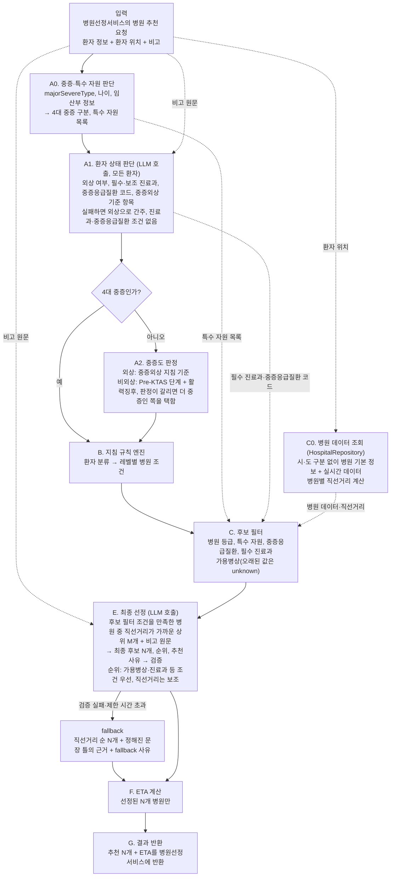

# PRD — 응급환자 이송 병원 추천 시스템

> 버전 v0.1 · 작성일 2026-10-28
> 근거: 이 문서는 2026-10-20 설계 초안과 구현 계획(일감 상태는 2026-10-22 기준)을 합쳐 만들었다. 요청·응답 형식은 [interface.md](interface.md), 중증외상 판정 기준은 [severe-trauma-criteria.md](severe-trauma-criteria.md), 병원 데이터 구조는 [erd_hospital.mmd](erd_hospital.mmd)를 따른다.

---

## 목차

0. [이 문서를 읽는 법](#0-이-문서를-읽는-법)
1. [배경과 목표](#1-배경과-목표)
2. [사용자와 외부 시스템](#2-사용자와-외부-시스템)
3. [시스템 구성](#3-시스템-구성)
4. [기술 스택](#4-기술-스택)
5. [기능 요구사항](#5-기능-요구사항)
6. [비기능 요구사항](#6-비기능-요구사항)
7. [공통 완료조건](#7-공통-완료조건)
8. [현재 구현과의 차이](#8-현재-구현과의-차이)
9. [결정 필요](#9-결정-필요)
10. [용어](#10-용어)

---

## 0. 이 문서를 읽는 법

(비어 있음)

---

## 1. 배경과 목표

### 1.1 배경

- 이 시스템은 병원선정서비스가 보낸 환자 정보와 환자의 현재 위치를 받아, 환자를 이송할 병원 후보 N개를 추천 근거와 함께 병원선정서비스에 반환한다.
- 이송병원 선정 기준은 119구급대 운영지침의 이송병원 선정 기준이다. 개발팀은 이 기준을 규칙 엔진의 설정 파일로 작성하고, 설정 파일의 버전을 관리한다.
- 시스템은 병원 정보를 Postgres에서 조회한다. 개발팀은 구체적인 조회 방법을 아직 정하지 않았다. 시스템은 `HospitalRepository` 인터페이스를 통해서만 병원 정보에 접근한다.
- 최종 이송 병원은 사람이 결정한다. 시스템은 병원을 추천만 하고, 구급대원과 지도의사가 최종 이송 병원을 결정한다.

### 1.2 목표

(비어 있음)

### 1.3 범위 밖

| 항목 | 이유 |
|---|---|
| 헬기 이송 판단 | 시스템은 헬기 이송을 우선 고려하지 않는다. 시스템은 헬기 이송이 필요한지 판단하지 않고, 응답에 헬기 이송 검토 권고를 넣지 않는다 |
| 신생아에게 필요한 특수 자원 | 시스템은 신생아를 우선 고려하지 않는다. 시스템은 `specialPatientInfo.newbornInfo` 값을 특수 자원 판단에 쓰지 않는다 |
| 비고에서 뇌졸중 선별검사 결과 추출 | 시스템은 비고에서 뇌졸중 선별검사 결과를 추출하지 않는다. 병원선정서비스가 선별검사 결과를 보낼 경로가 정해지기 전까지, 시스템은 뇌졸중 환자에게 '뇌졸중 의증' 규칙을 적용한다([§9 결정 필요](#9-결정-필요)의 '뇌졸중 선별검사 결과 경로') |
| 직접의료지도 요청(L2) — L0 조건(지침의 원칙 조건)과 L1 조건(의료지도를 받아야 적용할 수 있는 완화 조건) 모두에서 후보 병원이 0곳일 때 시스템이 반환하는 응답 | 이 문서는 직접의료지도 요청을 범위 밖으로 둔다(2026-10-28 결정). 후보 병원이 0곳이면 시스템은 병원을 추천하지 않는다([F-07 후보 필터와 레벨 진행](#f-07-후보-필터와-레벨-진행)) |
| 감사 로그, 사례 집계, 지역에 따라 달라지는 지침 | 세 항목은 중요하지만, 개발팀은 나머지 처리 흐름을 모두 정리한 뒤에 추가한다. 개발팀은 지금 이 항목들의 모듈을 만들지 않는다. 항목별 내용은 아래 '나중에 추가할 항목'에 있다 |

**나중에 추가할 항목**

- **감사 로그**
    - vLLM은 여러 요청을 묶어 처리하므로, temperature를 0으로 설정해도 같은 입력에 같은 출력이 나온다는 보장이 없다. 그래서 시스템은 판단에 사용한 데이터를 요청마다 저장해야 한다.
    - 실제 이송 결과를 `transport_case`에 적재하는 작업은 감사 로그를 이용해 실제 이송 결과를 해당 요청과 연결한다([§9 결정 필요](#9-결정-필요)의 '`transport_case` 적재').
    - 개발팀은 감사 로그를 `pipeline.py`의 마지막 단계에 추가한다. 이 단계는 프롬프트 버전, LLM 입력 객체, LLM 원문 출력을 함께 저장한다.
- **사례 집계 (추후 고려)**
    - 사례 집계는 후보 병원별 과거 수용률("이 유형의 환자를 각 후보 병원이 과거에 얼마나 수용했는가")을 계산해 최종 선정 LLM에 참고 정보로 넣는 기능이다.
- **지역에 따라 달라지는 지침 (응급의료 취약지역, 지역이송지침)**
    - 이 지침을 적용하려면 시스템이 환자 위치의 지역(시·군·구)을 판별해야 한다. 시스템은 지금 지역을 판별하지 않는다.
    - 지침 원문의 응급의료 취약지역 병원 조건은 다음과 같다.
        - 중증외상: 가장 가까운 지역응급의료기관 이상 (지침의 헬기 이송 선택지는 제외)
        - 비외상 중증: 가장 가까운 응급의료기관 이상
        - 뇌졸중 의증, 뇌졸중 선별검사 양성: 가장 가까운 지역응급의료기관
        - 경증외상, 비외상 경증, 심폐정지: 취약지역이 아닌 지역과 같은 조건
    - 지역이송지침: 환자가 지역이송지침을 운영하는 지역에 있고 그 지침의 적용 대상이면, 규칙 엔진은 분류별 규칙 표 대신 지역이송지침의 규칙을 적용한다.
    - 개발팀은 이 지침을 `rules.py`와 `config/transfer_rules.yaml`에 추가한다.

---

## 2. 사용자와 외부 시스템

| 구분 | 이름 | 하는 일 |
|---|---|---|
| 외부 시스템 | 병원선정서비스 | 병원선정서비스는 환자 정보, 환자 위치, 비고를 담아 시스템에 병원 추천을 요청하고, 시스템이 반환한 추천 결과를 받는다. 병원선정서비스는 입력 필드를 바꾸지 않는다 |
| 사람 | 구급대원, 지도의사 | 구급대원과 지도의사는 추천 결과를 참고해 최종 이송 병원을 결정한다. 응답에 "직접의료지도 필요" 표시가 있는 환자는 지도의사가 직접의료지도로 이송병원을 정하고, 이때 지도의사는 추천 목록을 참고할 수 있다 |
| 외부 시스템 | 병원 데이터(Postgres) | 병원 데이터 DB는 병원 기본 정보와 실시간 데이터(가용병상, 중증질환 수용가능 여부, 진료불가 메시지)를 제공한다. 시스템이 읽는 테이블은 [erd_hospital.mmd](erd_hospital.mmd)의 `tapi_*` 테이블이다 |
| 사람 | 개발팀 | 개발팀은 지침이 개정되면 규칙 설정 파일을 고친다. 개발팀은 프롬프트를 바꾸면 평가셋으로 결과를 확인한 뒤 배포한다 |

---

## 3. 시스템 구성

**핵심 원칙과 설계 방향**

- **규칙 엔진이 이송병원 선정 기준을 판정하고, 최종 선정 LLM은 규칙 엔진을 통과한 병원 중에서만 병원을 고른다.** 최종 선정 LLM은 규칙 엔진이 남긴 후보 병원 중에서 N개를 고르고 추천 근거를 작성한다. 환자 상태 판단 LLM은 환자의 외상 여부, 필요한 진료과, 중증응급질환, 환자에게 해당하는 중증외상 기준 항목을 판단할 뿐 병원을 고르지 않는다.
- **최종 선정 LLM은 거리보다 병원의 진료 여건을 먼저 본다.** LLM은 후보 병원의 순위를 정할 때 가용병상, 진료과 같은 조건을 환자 위치와 병원 사이의 직선거리보다 우선한다. LLM은 직선거리를 보조 기준으로 쓴다. 심폐정지 환자는 예외로, LLM은 직선거리가 가장 짧은 병원을 1순위에 둔다. LLM이 직선거리가 가장 짧은 병원이 아닌 병원을 1순위에 두면, 시스템은 그 추천에 우회 표시를 넣고 LLM이 우회 사유를 반드시 작성하게 한다.
- **시스템은 후보 병원이 없을 때 조건을 임의로 낮춰 추천하지 않는다.** 지침이 허용하는 모든 완화 단계를 적용해도 후보 병원이 0곳이면, 시스템은 병원을 추천하지 않는다.
- **시스템은 LLM 호출이 실패해도 항상 응답한다.**
    - 환자 상태 판단 LLM의 출력이 검증을 통과하지 못하거나 호출이 제한 시간을 넘기면, 시스템은 환자를 외상 환자로 간주하고, 필수 진료과 조건과 중증응급질환 조건을 적용하지 않고 후보 병원을 고른다.
    - 최종 선정 LLM의 출력이 검증을 통과하지 못하거나 호출이 제한 시간을 넘기면, 시스템은 직선거리가 짧은 순서로 병원 N개를 골라 응답한다. 이 문서는 이 처리를 fallback이라고 부른다.
- **개발팀은 모듈을 처리 단계 단위로 나눈다.** 처리 단계, 코드 모듈, 테스트가 같은 단위로 대응하므로, 지침이나 설계가 바뀌면 개발팀은 고칠 모듈을 바로 찾을 수 있다.
- **개발팀은 구현 교체가 정해진 세 곳에만 인터페이스를 둔다.**
    - `HospitalRepository`: 개발팀은 병원 조회 방법을 정하지 않았고, 구현 초기에 mock 병원 DB를 쓴다.
    - `EtaProvider`: 시스템은 ETA를 직선거리로 추정하고, 개발팀은 나중에 이 구현을 도로 기반 계산으로 교체한다.
    - `LlmClient`: 개발팀은 평가에서 두 후보 모델을 비교하고, 테스트에서 LLM 호출 실패와 제한 시간 초과를 일부러 일으킨다. 환자 상태 판단과 최종 선정이 같은 인터페이스를 쓴다.
- **개발팀은 코드 수정 없이 바꿔야 하는 데이터를 `src/` 밖 `config/`에 둔다.** 개발팀은 119구급대 운영지침이 개정되면 `config/`의 규칙 설정 파일을 수정한다.
- **처리 흐름의 분기는 다음 네 곳뿐이다.**
    - 환자 상태 판단 LLM이 실패하면, 시스템은 환자를 외상 환자로 간주하고 필수 진료과 조건과 중증응급질환 조건 없이 진행한다.
    - 시스템은 4대 중증 환자에게 중증도 판정을 하지 않는다.
    - 후보 병원이 0곳이면, 시스템은 다음 레벨의 조건으로 후보 필터를 다시 실행한다.
    - 최종 선정 LLM이 실패하면, 시스템은 fallback으로 응답한다.

**처리 흐름**



- 시스템은 요청 한 건당 LLM을 최대 2회 호출한다. 시스템은 환자 상태 판단(A1)에서 1회, 최종 선정(E)에서 1회 LLM을 호출한다.
- 레벨: L0은 지침의 원칙 조건이고, L1은 의료지도를 받아야 적용할 수 있는 완화 조건이다. 레벨별 조건은 [F-05 119 이송지침 규칙 엔진](#f-05-119-이송지침-규칙-엔진)의 분류별 규칙 표에 있다.
- 최종 선정 LLM이 실패하면 시스템은 fallback으로 응답한다. 시스템은 최종 선정이나 fallback으로 고른 병원 N개에만 ETA를 계산한다. ETA 계산 전 단계에서 시스템은 ETA 대신 환자 위치와 병원 사이의 직선거리를 쓴다.
- G단계는 결과 반환만 한다. 시스템이 실제 이송 병원과 수용/거절 결과를 매일 `transport_case` 테이블에 적재하는 작업은 일감에 없고, 적재 여부는 [§9 결정 필요](#9-결정-필요)의 '`transport_case` 적재' 항목에서 정한다.

**처리 순서** — `pipeline.py`는 다음 순서로 처리 단계를 호출한다.

```python
warnings   = []                                                    # 각 단계가 경고를 이 목록에 추가
if not req.vital_signs:                                            # 4대 중증 환자를 포함한 모든 환자
    warnings.append("활력징후 없음")
judgment   = severe_resource.judge(req)                            # A0
assessment = patient_assessment.assess(req, llm_client, warnings)  # A1, 모든 환자. LLM이 실패하면 None
category   = judgment.category or severity.judge(req, assessment)  # A2, 4대 중증이 아닐 때만
special    = severity.special_situations(req, category, assessment)  # 외상 환자만. 항목이 있으면 "직접의료지도 필요"
levels     = rules.levels_for(category)                            # B: [L0 조건, L1 조건]
hospitals  = repository.find_by_categories(categories_of(levels))  # C0: L0·L1 병원 분류를 합쳐 한 번 조회, 직선거리 포함
for level in levels:                                               # C: 후보가 0곳이면 다음 레벨
    candidates = filtering.apply(hospitals, level, judgment, assessment, warnings)
    if candidates:
        break
# L1 조건으로도 0곳이면 추천하지 않음 (직접의료지도 요청은 범위 밖)
picked = selection.select(...)                            # E, 실패하면 fallback
etas   = eta_provider.estimate(picked)                    # F: 선정된 N개만
return Recommendation(...)                                # api/response.py가 응답 JSON으로 변환
```

---

## 4. 기술 스택

**서비스** — 개발팀이 새로 추가하는 인프라는 vLLM 하나다. 개발팀은 나머지 기능을 기존 Postgres와 애플리케이션 코드로 구현한다.

| 구성 | 역할 | 기술 | 버전·비고 |
|---|---|---|---|
| 앱 (`service/` 아래 서비스 폴더, 폴더 이름 미정) | 병원 추천 API | **Python**, FastAPI, Pydantic | 앱 이미지의 기반 이미지는 `python:3.12-slim`이고, 앱은 root가 아닌 사용자로 실행한다. 패키지 이름 `transfer_recommender`는 임시 이름이다 |
| LLM 서빙 | 환자 상태 판단과 최종 선정의 LLM 호출 처리 | **vLLM** (로컬 서버) | 후보 모델은 qwen 3.8 flash next와 solar2 int4 GlobalPruned다(세부 사양 미확인). 시스템은 vLLM structured outputs(JSON 스키마)로 LLM 출력 형식을 제한하고, temperature를 0으로 둔다 |

**기존 인프라**

| 영역 | 기술 | 버전·비고 |
|---|---|---|
| DB | **Postgres** | pgvector를 쓸 수 없다. 시스템은 이 DB에서 병원 데이터를 조회한다 |

- 개발팀은 `compose.yaml`에 앱과 vLLM을 정의한다.
- 시스템은 LLM을 호출할 때 LangChain(`langchain-openai`)을 쓴다. LangChain은 `llm_client.py`의 `LlmClient` 구현 안에서만 쓰고, 다른 모듈은 LangChain을 import하지 않는다.
- 시스템은 꼭 필요하기 전에는 LangGraph, LangMem, 외부 프롬프트 관리 서비스, 임베딩 모델을 쓰지 않는다.
- 의존성: 개발팀은 실행 의존성(FastAPI, uvicorn, Pydantic, `langchain-openai`, PyYAML)을 `requirements.txt`에, 테스트 의존성(pytest, FastAPI TestClient용 httpx2)을 `requirements-dev.txt`에 둔다. 운영 이미지는 `requirements.txt`의 의존성만 설치한다.
- 거리: 최종 선정 전까지 시스템은 환자 위치와 병원 사이의 직선거리로 후보 병원을 정렬하고, LLM에 넣을 상위 M개 병원을 고르고, 우회를 판정하고, fallback의 병원 순서를 정한다. 시스템은 ETA를 최종 선정된 병원 N개에만 계산한다([F-10 ETA 계산](#f-10-eta-계산)).

**코드 구조**

```
service/(폴더 이름 미정)/
├── src/transfer_recommender/
│   ├── main.py                       # FastAPI 앱 생성, 라우터 등록
│   ├── logging_config.py             # 로깅 설정: 표준 출력, LOG_LEVEL 환경 변수, uvicorn 로그 형식 통일
│   ├── settings.py                   # 설정값: N, M, X, 병상 데이터 신선도 임계치, 중환자실 조건 적용 여부,
│   │                                 #   LLM 제한 시간(환자 상태 판단, 최종 선정), vLLM 대기 요청 상한, ETA 추정 속도,
│   │                                 #   사용할 프롬프트 버전(환자 상태 판단, 최종 선정), config/ 위치
│   ├── pipeline.py                   # 처리 단계 호출 순서, L0→L1 레벨 진행, fallback 전환, 경고 수집
│   ├── llm_client.py                 # LlmClient 인터페이스, LangChain 기반 vLLM 구현 (환자 상태 판단과 최종 선정이 함께 씀)
│   │
│   ├── api/
│   │   ├── routes.py                 # POST 병원 추천 요청 (경로 미정), GET /healthz
│   │   ├── request.py                # interface.md 요청 스키마, 필수 여부 규칙 위반 시 400 반환
│   │   └── response.py               # 응답 스키마 (interface.md에서 TBA 상태라 초안으로 작성)
│   │
│   ├── domain/                       # 단계 사이에 주고받는 데이터 타입
│   │   ├── types.py                  # 열거형: 4대 중증 구분, 적용 규칙, 레벨, 특수 자원, 병원 분류, 진료과,
│   │   │                             #   중증응급질환 코드, 중증외상 기준 항목, 경고
│   │   ├── patient.py                # 환자 분류 결과: 4대 중증 구분, 특수 자원 목록, 환자 상태 판단 결과
│   │   │                             #   (LLM 출력 스키마로도 씀), 적용 규칙
│   │   ├── hospital.py               # Hospital: 병원 분류, 진료과, 좌표, 중증질환 수용가능, 진료불가 메시지,
│   │   │                             #   응급실 11종·중환자실 19종 가용병상과 갱신 시각(data_as_of)
│   │   └── recommendation.py         # 추천 N개, 추천 사유와 출처, 우회 표시, "의료지도 필요" 표시,
│   │                                 #   "직접의료지도 필요" 표시와 특수상황 항목, 경고, fallback 사유
│   │
│   ├── classification/               # 환자 분류
│   │   ├── prompts/
│   │   │   └── patient_assessment_v1.md  # 환자 상태 판단 시스템 프롬프트
│   │   ├── severe_resource.py        # 중증·특수 자원 판단 (A0)
│   │   ├── patient_assessment.py     # 환자 상태 판단 (A1): LLM 입력 객체 생성, system·user 메시지 조립,
│   │   │                             #   LlmClient 호출, 실패 처리
│   │   └── severity.py               # 중증도 판정 (A2), 외상 환자의 특수상황 판정
│   │
│   ├── rules.py                      # 119 이송지침 규칙 엔진 (B): 적용 규칙 → [L0 조건, L1 조건]
│   │
│   ├── hospitals/                    # 병원 데이터 조회 (C0)
│   │   ├── repository.py             # HospitalRepository 인터페이스, 병원마다 직선거리를 계산해 넣는 함수
│   │   ├── mock.py                   # mock 병원 DB
│   │   └── postgres.py               # Postgres 구현
│   ├── geo.py                        # 직선거리 계산
│   ├── filtering.py                  # 후보 필터 (C)
│   │
│   ├── selection/                    # 최종 선정 (E)과 fallback
│   │   ├── prompts/
│   │   │   └── final_selection_v1.md # 최종 선정 시스템 프롬프트
│   │   ├── prompt.py                 # LLM 입력 객체 생성, system·user 메시지 조립 (LangChain 미사용)
│   │   ├── output_schema.py          # LLM 출력 Pydantic 모델
│   │   ├── detour.py                 # 우회 판정
│   │   ├── validator.py              # LLM 출력 검증
│   │   └── fallback.py               # fallback 선정
│   │
│   └── eta.py                        # ETA 계산 (F): EtaProvider 인터페이스, 직선거리 기반 구현
├── config/
│   └── transfer_rules.yaml           # 분류별 규칙 표(레벨별 병원 분류 목록), 활력징후 임계치(외상, 비외상), 정상 의식상태 목록
├── tests/
│   ├── fixtures/                     # mock 병원 데이터, 예시 요청, 프롬프트 기대 파일
│   └── ...                           # 모듈별 단위 테스트, 입력부터 응답까지 전체 흐름 테스트, 테스트용 가짜 LlmClient
└── Dockerfile                        # 앱 이미지 (python:3.12-slim, root가 아닌 사용자로 실행)
eval/                                 # 평가셋 생성, 평가 실행. 리포트는 eval/reports/에 두고 커밋하지 않는다
eval_set/                             # 평가셋. 이름에 synthetic이 들어간 합성 평가셋만 커밋한다
compose.yaml                          # 앱, vLLM
```

---

## 5. 기능 요구사항

| ID | 기능 | 처리 단계 | 모듈 |
|---|---|---|---|
| [F-01](#f-01-요청-수신과-검증) | 요청 수신과 검증 | — | `api/routes.py`, `api/request.py` |
| [F-02](#f-02-중증특수-자원-판단) | 중증·특수 자원 판단 | A0 | `classification/severe_resource.py` |
| [F-03](#f-03-환자-상태-판단) | 환자 상태 판단 | A1 | `classification/patient_assessment.py`, `classification/prompts/`, `llm_client.py` |
| [F-04](#f-04-중증도-판정과-특수상황-판정) | 중증도 판정과 특수상황 판정 | A2 | `classification/severity.py` |
| [F-05](#f-05-119-이송지침-규칙-엔진) | 119 이송지침 규칙 엔진 | B | `rules.py`, `config/transfer_rules.yaml` |
| [F-06](#f-06-병원-데이터-조회) | 병원 데이터 조회 | C0 | `hospitals/`, `geo.py` |
| [F-07](#f-07-후보-필터와-레벨-진행) | 후보 필터와 레벨 진행 | C | `filtering.py`, `pipeline.py` |
| [F-08](#f-08-최종-선정) | 최종 선정 | E | `selection/` 중 `fallback.py`를 뺀 모듈, `llm_client.py` |
| [F-09](#f-09-fallback) | fallback | 최종 선정(E)이 실패했을 때 | `selection/fallback.py` |
| [F-10](#f-10-eta-계산) | ETA 계산 | F | `eta.py` |
| [F-11](#f-11-결과-반환) | 결과 반환 | G | `pipeline.py`, `api/response.py`, `domain/recommendation.py` |
| [F-12](#f-12-모델-평가) | 모델 평가 | — | `eval/`, `eval_set/` |

- **구현 순서:** 개발팀은 구현을 다음 4단계로 나눠 진행한다.
    - 1단계(요청 검증·환자 분류·규칙 엔진): F-01 요청 수신과 검증, F-02 중증·특수 자원 판단, F-03 환자 상태 판단, F-04 중증도 판정과 특수상황 판정, F-05 119 이송지침 규칙 엔진
    - 2단계(병원 조회·후보 필터·전체 흐름): F-06 병원 데이터 조회(Postgres 구현 제외), F-07 후보 필터와 레벨 진행, F-09 fallback, F-10 ETA 계산, F-11 결과 반환
    - 3단계(LLM 최종 선정): F-08 최종 선정
    - 4단계(모델 평가): F-12 모델 평가
    - 개발팀은 fallback을 3단계(LLM 최종 선정)가 아니라 2단계에서 구현한다. 2단계의 전체 흐름 검증에도 병원을 고르는 단계가 필요하기 때문이다.
    - 개발팀은 F-06 병원 데이터 조회의 Postgres 구현(데이터 준비)을 구현 순서와 별도로 진행한다.
- **기준 예시: 65세 남성, 발등 개방성 골절, Pre-KTAS 2단계.** 이 환자는 `majorSevereType` 값이 없으므로 중증도 판정(A2)을 거친다. 환자 상태 판단 LLM은 이 환자를 "외상, 정형외과 필수"로 판단한다. 발등 개방성 골절은 신체검사 소견 기준(두 개 이상의 근위부 긴뼈 골절, 압궤·벗겨진·썰린 사지 등)에 해당하지 않는다. Pre-KTAS 평가내용과 비고에 손상기전 기준에 해당하는 내용(예: 6m 이상 추락)이 없으면, LLM은 중증외상 기준 항목을 고르지 않는다. 이 환자는 활력징후가 안정적이고 의식이 명료하므로 생리학적 기준에도 해당하지 않는다. 그래서 시스템은 이 환자에게 경증외상 규칙을 적용한다. 다만 환자가 65세이므로 특수상황의 위험한 나이(55세 이상)에 해당하고, 시스템은 응답에 "직접의료지도 필요" 표시를 넣는다. 후보 필터는 정형외과 진료가 불가능한 병원을 후보에서 제거한다. 최종 선정 LLM은 남은 후보 중 가용병상과 정형외과 여건이 더 나은 병원을 직선거리가 가장 짧은 병원보다 앞 순위에 둘 수 있고, 이때 시스템은 그 추천에 우회 표시를 넣는다.

### F-01 요청 수신과 검증

**요구사항**

- 병원선정서비스는 환자 정보와 환자 위치를 담아 시스템에 병원 추천을 요청한다. 요청의 형식(필드명, 타입, 필수 여부)은 [interface.md](interface.md)의 '병원 추천 요청' 섹션이 정한다.
- 시스템은 interface.md의 '필수 여부 규칙'대로 요청을 검증한다.
    - 필수 필드의 키가 없거나 `null`을 허용하지 않는 필드의 값이 `null`이면, 시스템은 400을 반환한다. FastAPI는 요청 검증 오류에 기본으로 422를 반환하므로, `main.py`는 검증 오류 처리기를 등록해 400을 반환한다.
    - 시스템은 타입에 `null`이 있거나 '생략 시 처리' 값이 `null`인 필드에만 `null`을 받는다. '생략 시 처리' 값이 `[]`나 `1`인 optional 필드(`symptoms`, `vitalSigns`, `medicalHistory`, `medications`, `preKtas.assessmentRound`)에 `null`이 오면, 시스템은 400을 반환한다.
    - 시스템은 숫자 필드에 JSON 숫자만 받는다. 숫자 필드에 불리언, 문자열(예: `"65"`), `NaN`, `Infinity`가 오면, 시스템은 400을 반환한다.
    - 명세에 없는 키가 오면, 시스템은 400을 반환한다. 이 규칙은 키 이름의 오타 때문에 필드 값이 기본값으로 바뀌는 것을 막는다.
    - 시스템은 `patientInfo.age`에 소수(예: 생후 6개월 0.5세)도 받는다. interface.md가 이 필드의 타입을 number로 정했기 때문이다.
    - 시스템은 `majorSevereType`에 4대 중증 4종(심정지, 중증외상, 뇌졸중, 심근경색)만 받는다. 다른 값이 오면 시스템은 400을 반환한다. 시스템이 모르는 값을 무시하면 4대 중증 환자를 일반 환자로 분류하기 때문이다.
    - optional 필드의 키가 생략되면, 시스템은 interface.md '생략 시 처리' 열의 값을 그 필드에 넣는다.
    - `specialPatientInfo` 키가 없으면, 시스템은 400을 반환한다. `specialPatientInfo`의 하위 필드 값이 `null`이면, 시스템은 그 하위 필드를 "해당 없음"으로 간주한다.
- 시스템은 검증 오류 응답에 필드 위치(`loc`), 메시지(`msg`), 오류 종류(`type`)만 넣는다. Pydantic 기본 오류의 `input` 항목은 환자 정보가 담긴 요청 본문을 그대로 되돌려 주므로, 시스템은 `input` 항목을 응답에서 뺀다.
- 시스템은 각 입력 필드를 다음과 같이 사용한다.

| 입력 필드 | 시스템이 이 필드를 사용하는 목적 | 처리 방식 |
| --- | --- | --- |
| `majorSevereType` (4대중증구분) | 지침의 환자 분류(심정지, 중증외상, 뇌졸중, 심근경색)를 바로 결정 | 규칙, 다른 필드보다 우선 적용 |
| `preKtas.assessmentDetail` (Pre-KTAS 평가내용) | Pre-KTAS(병원 전 단계 중증도 분류)의 평가 항목 문구. 외상 여부, 필수·보조 진료과, 중증응급질환 코드, 중증외상 기준 항목(신체검사 소견, 손상기전)을 판단하는 데 사용. 사례 집계 키 | LLM 입력 (환자 상태 판단) |
| `preKtas.level` (Pre-KTAS 단계) | 비외상 환자의 중증도 판정 (1~2단계면 중증 후보). 외상 환자는 활력징후 측정값이 없거나 환자 상태 판단이 실패했을 때만 중증외상 판정에 사용. 환자 상태 판단 시 참고 | 규칙 + LLM 입력 |
| `vitalSigns` (활력징후) | 중증외상의 생리학적 기준 판정, 환자 상태 판단과 최종 선정 시 참고 | 규칙 + LLM 입력 |
| `consciousnessLevel` (의식상태) | 중증외상 기준 판정, 환자 상태 판단과 최종 선정 시 참고 | 규칙 + LLM 입력 |
| `patientInfo.age` (나이) | 15세 미만이면 소아응급 진료 가능 조건을 후보 필터에 추가. 외상 환자가 55세 이상이거나 10세 이하이면 "직접의료지도 필요" 표시(중증외상 지침의 위험한 나이). 환자 상태 판단 시 참고 | 규칙 + LLM 입력 |
| `specialPatientInfo` (특수환자정보) | 임산부면 분만 가능 조건을 후보 필터에 추가. 임산부 정보(`pregnancyInfo`)는 환자 상태 판단 LLM에도 넣어 임신 20주 이상인지 판단(중증외상 지침의 특수상황). 신생아 정보는 우선 고려하지 않음 | 규칙 (완화 불가 조건) + LLM 입력 |
| `medicalHistory` (과거력), `medications` (투여약물) | 환자 상태 판단 LLM이 진료과와 중증외상 지침의 특수상황(항응고·출혈성 질환, 투석이 필요한 말기신장질환)을 판단할 때, 최종 선정 LLM이 선정 근거를 쓸 때 참고 (예: 당뇨 + 혈당 210 → 감염 위험 언급) | LLM 입력만 |
| `patientLocation` (환자위치, WGS84 경도·위도) | 직선거리·ETA 계산, 사례 집계의 지역 키 | 코드로 계산 |
| `remark` (비고) | 환자 상태 판단 LLM이 중증외상 기준 항목(손상기전, 신체검사 소견)을 판단할 때, 최종 선정 LLM이 최종 후보, 순위, 추천 사유를 정할 때 참고 (예: 3층 높이에서 추락, 환자가 희망하는 병원). 비고에 적힌 거절 병원은 후보에서 제거하지 않음 | LLM 입력만 |

**완료조건**

- [ ] 앱 서버가 기동되고 `pytest`가 실행된다(프로젝트 골격 일감).
- [ ] 팀이 도메인 타입을 리뷰해 확정한다(프로젝트 골격 일감).
- [ ] interface.md '필수 여부 규칙'의 경우마다 테스트가 있다.
    - [ ] 필수 키가 없는 요청에 시스템이 400을 반환한다.
    - [ ] `null`을 허용하지 않는 필드에 `null`이 온 요청에 시스템이 400을 반환한다.
    - [ ] optional 키가 생략된 요청에 시스템이 기본값을 넣는다.
    - [ ] `specialPatientInfo` 키가 없는 요청에 시스템이 400을 반환하고, 하위 필드가 `null`인 요청은 시스템이 정상 처리한다.
    - [ ] `majorSevereType`에 4대 중증 4종이 아닌 값이 온 요청에 시스템이 400을 반환한다.

### F-02 중증·특수 자원 판단

**요구사항**

- 시스템은 요청을 받으면 가장 먼저 환자가 4대 중증에 해당하는지와 환자에게 특수 자원이 필요한지 판단한다. 이 단계에서 시스템은 LLM을 쓰지 않고 입력 필드 값만 본다.
- 입력 필드: `majorSevereType`, `patientInfo.age`, `specialPatientInfo.pregnancyInfo`
- 출력
    - `severe_type`: 4대 중증 구분 (심정지, 중증외상, 뇌졸중, 심근경색 중 하나, 또는 없음)
    - `required_resources[]`: 환자에게 필요한 특수 자원 목록. 목록이 비어 있으면 환자에게 특수 자원이 필요 없다.
- 출력을 쓰는 단계
    - `severe_type` 값이 있으면, 시스템은 중증도 판정(A2)을 건너뛰고 아래 판정 규칙 표의 적용 규칙을 지침 규칙 엔진(B)에 넘긴다.
    - `severe_type` 값이 없으면, 시스템은 중증도 판정(A2)에서 Pre-KTAS 단계와 활력징후로 적용 규칙을 정한다.
    - `severe_type` 값과 관계없이 모든 환자는 환자 상태 판단(A1)을 거친다.
    - 후보 필터(C)는 `required_resources[]`의 자원을 완화할 수 없는 조건으로 적용한다.
- 시스템은 소아와 임산부 여부로 처리 흐름을 나누지 않는다. 소아와 임산부도 중증일 수 있고 경증일 수 있어서, 시스템은 이 환자들도 Pre-KTAS로 분류해야 한다. 예를 들어 7세 손목 골절 환자에게는 소아 응급 진료 자원이 필요하지만, 시스템은 이 환자에게 경증외상 규칙을 적용한다.

| 판정 근거 | 적용 규칙 | 특수 자원 | 병원 데이터 (erd_hospital.mmd) |
| --- | --- | --- | --- |
| `majorSevereType` = 심정지 | 심폐정지 | 없음 | - |
| `majorSevereType` = 중증외상 | 중증외상 | 없음 | - |
| `majorSevereType` = 뇌졸중 | 뇌졸중 | 뇌경색 재관류중재술 또는 뇌출혈수술 (둘 중 하나라도 가능하면 충족) | 중증질환환자수용가능정보 `mkioskty2`([재관류중재술] 뇌경색), `mkioskty3`·`mkioskty4`([뇌출혈수술]) |
| `majorSevereType` = 심근경색 | 비외상 중증 | 심근경색 재관류중재술 | 중증질환환자수용가능정보 `mkioskty1`([재관류중재술] 심근경색) |
| `patientInfo.age` < 15 | - | 소아 응급 진료 | 응급실시간가용병상정보 `hv28`(소아) |
| `specialPatientInfo.pregnancyInfo` 값 있음 | - | 분만 | 중증질환환자수용가능정보 `mkioskty16`([산부인과응급] 분만) |

- 이송지침은 심정지 환자를 병원 규모(등급) 조건을 만족하는 병원 중 가장 가까운 병원으로 이송하도록 정한다. 그래서 심정지 행에는 특수 자원이 없다.
- 환자가 적용 규칙 열이 '-'인 행에 해당해도, 시스템은 그 환자의 적용 규칙을 바꾸지 않는다. 이 환자의 적용 규칙은 4대 중증 구분이나 중증도 판정(A2)이 정한다.
- 시스템은 중증외상 환자의 권역외상센터 조건을 특수 자원으로 두지 않는다. 지침은 의료지도를 받으면 지역응급의료센터로 이송하는 것을 허용하므로, 시스템은 이 조건을 지침 규칙 엔진의 병원 등급 조건(L0 권역외상센터, L1 지역응급의료센터)으로 다룬다.
- 병원선정서비스가 뇌졸중 선별검사 결과를 보낼 경로가 없으므로, 시스템은 뇌졸중 환자에게 '뇌졸중 의증' 규칙을 적용한다.

**완료조건**

- [ ] 판정 규칙 표의 각 행에 대한 단위 테스트가 있다.
- [ ] 판정 규칙 표의 여러 행에 해당하는 환자에 대한 단위 테스트가 있다(예: 임산부 뇌졸중 환자에게 특수 자원 2개).

### F-03 환자 상태 판단

**요구사항**

- 모든 환자가 이 단계를 거친다. 시스템은 Pre-KTAS 평가 결과, 활력징후, 나이, 비고 같은 환자 정보를 LLM에 넣고, LLM은 환자의 외상 여부, 필수·보조 진료과, 중증응급질환 코드, 중증외상 기준 항목을 판단한다.
- 시스템은 외상 여부와 중증외상 기준 항목을 중증도 판정(A2)과 특수상황 판정에 넘기고, 필수 진료과와 중증응급질환 코드를 후보 필터(C)의 조건으로 넘기고, 보조 진료과를 최종 선정(E) LLM의 입력으로 넘긴다.
- 4대 중증 환자도 이 단계를 거친다. 예를 들어 Pre-KTAS 평가내용이 "개방성 골절"인 중증외상 환자에게는 '정형외과 필수' 조건이 붙는다.
- 시스템은 Pre-KTAS 조회 테이블(평가내용 문구별 외상 여부·진료과·중증응급질환 코드를 미리 적어 둔 표)을 쓰지 않고, 요청마다 LLM으로 판단한다([§9 결정 필요](#9-결정-필요)의 '환자 상태 판단 방식'). 의료진이 판단 결과를 미리 검토하지 않으므로, 개발팀은 평가셋으로 판단 정확도를 확인한다([F-12 모델 평가](#f-12-모델-평가)).
- 입력: Pre-KTAS 단계·평가내용, 나이, 성별, 주호소, 증상, 의식상태, 활력징후, 과거력, 투여약물, 임산부 정보, 비고
    - 손상기전과 신체검사 소견은 Pre-KTAS 평가내용이나 비고에만 적힐 수 있다. 그래서 시스템은 비고도 LLM 입력에 넣는다.
- 출력

| 항목 | 값 | 쓰는 단계 | 예시 (발등 개방성 골절) |
| --- | --- | --- | --- |
| `is_trauma` (외상 여부) | true 또는 false | 중증도 판정(A2) | true |
| `required_depts` (필수 진료과) | 진료과 목록에서 0개 이상 | 후보 필터(C)의 완화할 수 없는 조건 | 정형외과 |
| `supportive_depts` (보조 진료과) | 진료과 목록에서 0개 이상 | 최종 선정(E) LLM 입력 | 성형외과, 혈관외과 |
| `severe_disease_code` (중증응급질환 코드) | `mkioskty1`~`mkioskty27` 중 하나, 또는 null | 후보 필터(C)의 완화할 수 없는 조건 | null |
| `trauma_criteria` (중증외상 기준 항목) | "다발성/중증손상" 지침의 신체검사 소견, 손상기전, 특수상황 항목 중 0개 이상. 시스템이 나이로 판정하는 위험한 나이 항목은 뺀다 | 중증도 판정(A2), 특수상황 판정 | 없음 |

- 값 제한: 시스템은 vLLM structured outputs(JSON 스키마)로 LLM이 진료과, 중증응급질환 코드, 중증외상 기준 항목을 정해진 값 목록 안에서만 고르게 한다.
    - 진료과 목록은 병원 데이터의 진료과목(`qd`)과 같은 이름을 써야 한다. 그래야 후보 필터가 두 값을 비교할 수 있다. 값 목록이 정해지기 전까지 개발팀은 임시 진료과 목록을 쓴다([§9 결정 필요](#9-결정-필요)의 '진료과 값 목록').
    - 중증응급질환 코드는 중증질환환자수용가능정보조회의 `mkioskty1`~`mkioskty27`이다.
    - 중증외상 기준 항목은 [severe-trauma-criteria.md](severe-trauma-criteria.md)의 신체검사 소견, 손상기전, 특수상황 항목이다.
- 개발팀은 출력 스키마를 `domain/patient.py`의 환자 상태 판단 결과 Pydantic 모델 하나에서만 만든다. 중증도 판정과 후보 필터도 이 모델을 결과 타입으로 받는다.
- 시스템 프롬프트의 지시문: LLM은 Pre-KTAS 평가내용, 주호소, 증상, 비고에 적힌 내용에 해당하는 항목만 고른다. LLM은 적혀 있지 않은 손상기전이나 소견을 추측해 고르지 않는다.
- `patient_assessment.py`는 [N-01 프롬프트 관리](#n-01-프롬프트-관리)에 적은 방식으로 system·user 메시지를 만들고 `LlmClient`를 호출한다.
    - `LlmClient`는 OpenAI chat 형식의 메시지 목록(`messages`), 출력 모델(`response_format`), 제한 시간(`timeout`)을 받는다. `LlmClient`는 파싱한 출력과 LLM 원문 출력을 반환하거나, 실패 사유(호출 실패, 검증 실패, 제한 시간 초과, vLLM 대기 요청 초과)를 반환한다. 호출 실패는 연결 오류처럼 vLLM이 응답하지 못한 경우다. 매개변수 이름은 OpenAI SDK의 `chat.completions.parse()`와 같다.
    - 개발팀은 테스트용 가짜 `LlmClient`를 `tests/`에 만든다. 가짜 클라이언트는 테스트 설정에 따라 정상 출력이나 실패 사유를 반환한다.
- 제한 시간: 시스템은 환자 상태 판단 LLM 호출에 3초(임시값)의 제한 시간을 둔다.
- 실패 처리
    - 실패 조건: LLM 호출이 실패함(연결 오류 등), LLM 출력이 스키마 검증을 통과하지 못함, LLM 호출이 제한 시간을 넘김, vLLM 대기 요청 수가 정해진 값을 넘음(이때 시스템은 LLM을 호출하지 않는다)
    - `LlmClient`가 실패 사유를 반환하면, `patient_assessment.py`는 결과 없음(`None`)을 반환한다.
    - 중증도 판정(A2)은 환자를 외상 환자로 간주한다. 시스템은 신체검사 소견 기준과 손상기전 기준을 판정할 수 없으므로, 환자가 Pre-KTAS 1~2단계이거나 생리학적 기준에 해당하면 중증외상으로 판정한다.
    - 특수상황 판정은 위험한 나이 항목만 판정한다.
    - 후보 필터(C)는 필수 진료과 조건과 중증응급질환 조건을 적용하지 않는다.
    - 시스템은 응답에 "환자 상태 판단 실패" 경고를 넣는다.

**완료조건**

- [ ] 발등 개방성 골절 예시로 만든 메시지를 기대 파일과 비교하는 테스트가 있다.
- [ ] LLM 입력 객체에 비고와 임산부 정보가 들어가는지 확인하는 테스트가 있다.
- [ ] 가짜 클라이언트가 실패 사유를 반환하면, 실패 사유마다 결과 없음과 "환자 상태 판단 실패" 경고가 나오는지 확인하는 테스트가 있다.
- [ ] 출력 모델이 목록 밖의 중증외상 기준 항목을 거부하는지 확인하는 테스트가 있다.
- [ ] 환자 상태 판단 LLM 호출 실패를 일부러 일으키면, 시스템이 필수 진료과 조건과 중증응급질환 조건 없이 "환자 상태 판단 실패" 경고와 함께 응답한다.

### F-04 중증도 판정과 특수상황 판정

**요구사항**

- 4대 중증이 아닌 환자(중증·특수 자원 판단(A0)에서 `severe_type` 값이 없는 환자)만 중증도 판정을 거친다. `pipeline.py`는 이 환자에게만 `severity.judge`를 호출한다.
- 외상 환자: 시스템은 "다발성/중증손상" 지침([severe-trauma-criteria.md](severe-trauma-criteria.md))의 기준 중 하나라도 해당하면 환자를 중증외상으로 판정한다([§9 결정 필요](#9-결정-필요)의 '중증외상 판정 기준').
    - 생리학적 기준: 시스템은 활력징후와 의식상태로 판정한다. 기준은 의식상태 V(언어 반응) 이하, 수축기혈압 90mmHg 미만, 호흡수 분당 10회 미만 또는 29회 초과다.
        - 시스템은 `consciousnessLevel` 값이 `명료`가 아니면 의식상태를 V 이하로 간주한다.
        - 요청에 GCS(글라스고우 혼수척도)가 없으므로, 시스템은 GCS 기준을 쓰지 않는다.
        - 지침에 산소포화도 기준이 없으므로, 시스템은 외상 환자의 판정에 산소포화도를 쓰지 않는다.
    - 신체검사 소견 기준과 손상기전 기준: 환자 상태 판단 결과의 중증외상 기준 항목에 이 두 분류의 항목이 하나라도 있으면, 시스템은 환자를 중증외상으로 판정한다. 시스템은 특수상황 항목을 중증외상 판정에 쓰지 않는다.
        - 요청에는 이 기준들의 정형 필드가 없고, 병원선정서비스는 입력 필드를 바꾸지 않는다. 그래서 LLM은 Pre-KTAS 평가내용, 주호소, 증상, 비고에 적힌 내용으로만 판단한다. 텍스트에 내용이 적혀 있지 않으면, 시스템은 생리학적 기준만으로 판정한다.
        - 그래서 시스템은 손상기전 정보가 없는 중증외상 환자(예: 6m 높이에서 추락했지만 활력징후가 정상이고 비고에 추락 높이가 없는 환자)를 경증외상으로 분류할 수 있다.
    - 수축기혈압과 호흡수 측정값이 하나도 없으면, 시스템은 Pre-KTAS 1~2단계인 외상 환자도 중증외상으로 판정한다.
    - 환자 상태 판단 결과가 없으면, 시스템은 환자를 외상 환자로 간주한다. 이때 환자가 Pre-KTAS 1~2단계이거나 외상 임계치를 넘으면 시스템은 중증외상으로, 그렇지 않으면 경증외상으로 판정한다.
- 비외상 환자: 시스템은 Pre-KTAS 단계(1~2단계면 중증)와 비외상 임계치로 각각 중증도를 판정하고, 두 판정이 다르면 더 중증인 쪽을 택한다.
- 시스템은 외상 여부와 중증도로 적용 규칙(중증외상, 경증외상, 비외상 중증, 비외상 경증)을 정해 지침 규칙 엔진(B)에 넘긴다.
- **판정이 갈리면 시스템은 더 중증인 쪽을 택한다.** 개발팀은 활력징후 임계치를 "측정값이 이 값을 넘으면 중증으로 판정한다"는 조건으로 규칙 설정 파일에 작성한다.
    - 외상 환자의 임계치(수축기혈압, 호흡수, 의식 수준)는 "다발성/중증손상" 지침의 값이다.
    - 비외상 환자의 임계치는 임시값이다: 수축기혈압 90mmHg 미만, 산소포화도 90% 미만, 의식상태가 "명료"가 아님([§9 결정 필요](#9-결정-필요)의 '활력징후 임계치 임시값').
    - 시스템은 요청에서 활력징후 기록을 한 건만 받는다.
    - 의식상태는 `vitalSigns`와 별개인 필수 필드다. 그래서 활력징후가 빈 배열이어도 시스템은 의식상태로 중증도를 판정한다.
- 요청의 `preKtas`에는 Pre-KTAS 평가 결과가 한 건만 들어간다. `preKtas.assessmentRound`는 그 평가의 차수다. 평가를 여러 차례 했을 때 병원선정서비스가 어느 차수의 결과를 보내는지는 정해지지 않았다([§9 결정 필요](#9-결정-필요)의 'Pre-KTAS 평가 차수').
- **특수상황 판정:** 적용 규칙이 중증외상이나 경증외상인 환자(4대 중증 구분이 중증외상인 환자 포함)가 "다발성/중증손상" 지침의 '의학적 질병상태 및 특수상황'에 해당하면, 시스템은 응답에 "직접의료지도 필요" 표시와 해당 항목을 넣는다.
    - 지침은 이 환자의 이송병원을 직접의료지도로 정하라고 규정한다. 시스템은 추천을 그대로 반환하고, 지도의사는 추천 목록을 참고할 수 있다.
    - 위험한 나이(55세 이상, 10세 이하): 시스템은 `patientInfo.age`로 판정한다.
    - 나머지 항목(항응고·출혈성 질환, 화상과 외상 동반, 투석이 필요한 말기신장질환, 시간 지연에 민감한 사지 손상, 임신 20주 이상, 구급대원의 판단): 시스템은 환자 상태 판단 결과의 중증외상 기준 항목 중 특수상황 항목을 가져온다. 환자 상태 판단 결과가 없으면, 시스템은 위험한 나이만 판정한다.
    - `pipeline.py`는 4대 중증 환자에게도 특수상황 판정을 호출한다. 4대 중증 구분이 중증외상인 환자는 중증도 판정을 건너뛰지만 특수상황 판정의 대상이기 때문이다.

**완료조건**

- [ ] Pre-KTAS 단계는 경증인데 활력징후가 임계치를 넘으면, 시스템이 중증으로 판정하는지 확인하는 테스트가 있다.
- [ ] 시스템이 발등 개방성 골절 예시를 경증외상으로 판정하고, 특수상황 항목으로 위험한 나이를 반환하는지 확인하는 테스트가 있다.
- [ ] Pre-KTAS 3~5단계 외상 환자도 외상 임계치를 넘으면, 시스템이 중증외상으로 판정하는지 확인하는 테스트가 있다(호흡수 10회 미만, 29회 초과 각각).
- [ ] 외상 환자의 산소포화도가 90% 미만이어도 다른 기준에 해당하지 않으면, 시스템이 경증외상으로 판정하는지 확인하는 테스트가 있다.
- [ ] 활력징후가 정상이어도 신체검사 소견이나 손상기전 항목이 있으면 중증외상으로, 특수상황 항목만 있으면 경증외상으로 시스템이 판정하는지 확인하는 테스트가 있다.
- [ ] 환자 상태 판단 결과가 없으면, 시스템이 환자를 외상 환자로 간주하고 판정하는지 확인하는 테스트가 있다.
- [ ] 특수상황 판정 테스트가 있다: 나이 경계값(10, 10.5, 54.9, 55), 적용 규칙이 비외상이면 빈 목록 반환, 4대 중증 구분이 중증외상인 환자의 판정.

### F-05 119 이송지침 규칙 엔진

**요구사항**

- 지침은 환자 분류에 따라 병원의 최소 등급을 정하고, 그 등급 이상인 병원 중 가장 가까운 병원으로 이송하라고 규정한다. 규칙 엔진은 이 기준을 설정 파일로 표현하므로, 지침이 개정되면 개발팀은 코드 대신 설정 파일만 수정한다.
- 규칙 엔진은 환자 분류만 입력으로 받는다. 시스템은 환자 위치의 지역을 판별하지 않으므로, 개발팀은 지역에 따라 달라지는 지침을 나중에 추가한다([§1.3 범위 밖](#13-범위-밖)의 '나중에 추가할 항목').

| 환자 분류 | L0 원칙 조건 | L1 완화 조건 (의료지도 필요) |
| --- | --- | --- |
| 중증외상 | 가장 가까운 권역외상센터 (시·도와 관계없음) | 지역응급의료센터 |
| 경증외상 | 가장 가까운 지역응급의료기관 | 없음 |
| 비외상 중증 | 지역응급의료센터 이상 | 지역응급의료기관 |
| 비외상 경증 | 가장 가까운 지역응급의료기관 | 없음 |
| 심폐정지 | 가장 가까운 지역응급의료기관 이상 | 없음 |
| 뇌졸중 의증 | 지역응급의료센터 이상 | 지역응급의료기관 |
| 뇌졸중 선별검사 양성 | 즉시 혈전용해 치료가 가능한 지역응급의료기관 이상 | 지역응급의료기관 |

- 후보 필터는 분류별 규칙 표의 병원 등급 조건을 적용한다. 표의 "가장 가까운"은 후보 필터의 조건이 아니다. 등급 조건을 만족한 병원 사이의 순위는 최종 선정 LLM이 정하고, 최종 선정 LLM은 직선거리를 보조 기준으로 쓴다.
- 시스템은 지침의 "권역외상센터가 지정되지 않은 지역은 지역응급의료센터 이상" 조항을 적용하지 않는다. 시스템은 시·도와 관계없이 가장 가까운 권역외상센터를 찾는다. 거리 상한이 없으므로, 권역외상센터가 먼 지역에서도 중증외상 환자의 L0 후보는 권역외상센터뿐이다.
- 시스템은 비고에서 뇌졸중 선별검사 결과를 추출하지 않는다. 병원선정서비스가 선별검사 결과를 보낼 경로가 정해지기 전까지, 규칙 엔진은 뇌졸중 환자에게 '뇌졸중 의증' 규칙을 적용한다.
- 개발팀은 분류별 규칙 표의 7행을 설정 파일(`config/transfer_rules.yaml`)에 작성한다. 각 행은 적용 규칙, L0 병원 등급 조건, L1 병원 등급 조건(없으면 비움)을 가진다.
- 개발팀은 레벨마다 병원 등급 조건을 허용하는 병원 분류(`HospitalCategory`) 목록으로 적는다. 예: "지역응급의료센터 이상" = 권역응급의료센터, 지역응급의료센터
    - 병원 분류는 권역응급의료센터, 지역응급의료센터, 지역응급의료기관, 권역외상센터 4종이다. 병원 하나가 여러 분류에 속할 수 있다(예: 권역응급의료센터이면서 권역외상센터). 전문응급의료센터는 소아, 화상처럼 특정 환자군만 맡으므로 병원 분류에 넣지 않는다([§9 결정 필요](#9-결정-필요)의 '병원 분류 범위').
    - 지침 문구에 "이상"이 없는 조건(예: 경증외상의 "지역응급의료기관")은 그 등급만 허용한다.
    - 뇌졸중 선별검사 양성 규칙의 "즉시 혈전용해 치료 가능" 조건에 해당하는 필드가 병원 데이터에 없다. 그래서 개발팀은 이 규칙에 등급 목록만 적는다([§9 결정 필요](#9-결정-필요)의 '혈전용해 조건').
- 설정 파일에는 버전 필드가 있다. 시스템은 응답의 적용 규칙 정보에 이 버전을 넣는다.
- `rules.py`는 앱 시작 시 설정 파일을 읽고 형식을 검사한다(필수 키 누락, 정의되지 않은 병원 분류). 설정 파일의 형식이 틀리면 앱이 기동되지 않는다.
- `rules.py`는 적용 규칙을 받아 [L0 조건, L1 조건] 목록을 반환한다. 레벨 진행은 `pipeline.py`가 맡는다([F-07 후보 필터와 레벨 진행](#f-07-후보-필터와-레벨-진행), [§9 결정 필요](#9-결정-필요)의 '레벨 진행 루프 위치').

**완료조건**

- [ ] 분류별 규칙 표의 각 행에 대한 단위 테스트가 있다.
- [ ] 형식이 틀린 설정 파일을 읽으면 `rules.py`가 실패하는지 확인하는 테스트가 있다.

### F-06 병원 데이터 조회

**요구사항**

- 시스템은 `HospitalRepository`로 병원 데이터를 조회한다. 시스템은 시·도 구분 없이 병원을 조회하고, 환자 위치와 각 병원 사이의 직선거리를 계산한다. 후보 필터(C)와 최종 선정(E)이 이 데이터를 쓴다.
- 시스템은 환자 위치의 시·도를 판별하지 않는다. 시스템은 직선거리로 가까운 병원을 고르므로, 지침의 "타 시·도 권역외상센터가 더 가까우면 그곳으로 이송할 수 있다"는 조항은 별도 처리 없이 지켜진다.
- `HospitalRepository`는 선택한 병원 분류 중 하나 이상에 속하는 병원을 시·도 구분 없이 반환한다. `pipeline.py`는 적용 규칙의 L0 조건과 L1 조건에 나오는 병원 분류를 합쳐 한 번만 조회하고, 조회한 목록 안에서 레벨을 진행한다.
- `geo.py`는 WGS84 좌표 두 점 사이의 직선거리(km)를 계산한다. `repository.py`는 조회한 병원마다 환자 위치와의 직선거리를 계산해 넣는 함수를 둔다. mock 구현과 Postgres 구현이 이 함수를 함께 쓴다.
- `hospital.py`는 병원의 진료과를 환자 상태 판단 결과와 같은 진료과 열거형으로 나타낸다. 그래야 후보 필터가 두 값을 비교할 수 있다.

| 데이터 | 쓰는 곳 | 병원 데이터 (erd_hospital.mmd) |
| --- | --- | --- |
| 응급의료기관 등급, 진료과목, 병원 좌표 | 후보 필터의 병원 등급·필수 진료과 조건, 직선거리 계산 | 응급의료기관목록정보조회 `dutyemcls`, `qd`, `wgs84lon`·`wgs84lat` |
| 외상센터 등급 | 후보 필터의 병원 등급 조건 (권역외상센터) | 외상센터위치정보조회 `dutylvkl` |
| 응급실·중환자실·소아 가용병상, 입력일시 | 후보 필터의 가용병상·특수 자원 조건, 실시간 데이터 신선도 판정, 최종 선정 | 응급실시간가용병상정보조회 `hvec`, `hvicc` 등, `hv28`, `hvidate` |
| 중증질환 수용가능 여부 | 후보 필터의 중증응급질환·특수 자원 조건, 최종 선정 | 중증질환환자수용가능정보조회 `mkioskty1` 등 |
| 응급실·중증질환 진료불가 메시지 | 후보 필터의 필수 진료과 조건, 최종 선정 | 응급실및중증질환메시지조회 `symblkmsg` |

- 개발팀은 mock 병원 데이터(`tests/fixtures/mock_hospitals.json`)를 다음과 같이 만든다.
    - 개발팀은 예시 환자 위치(경도 128.5911, 위도 35.8714) 주변 병원 15곳 정도를 넣는다.
    - 개발팀은 후보 필터의 조건마다 그 조건으로 제거되는 병원을 1곳 이상 넣는다.
    - 개발팀은 다른 시·도의 권역외상센터와 병상 데이터가 오래된 병원을 넣는다.
- Postgres 구현(`hospitals/postgres.py`)은 [erd_hospital.mmd](erd_hospital.mmd)의 `tapi_*` 테이블을 조회해 `Hospital`로 바꾼다.
    - 응급의료기관 등급: 응급의료기관목록정보조회 `dutyemcls`
    - 권역외상센터 지정: 외상센터위치정보조회 `dutylvkl`
    - 진료과목: 응급의료기관목록정보조회 `qd`. `postgres.py`는 `qd` 값을 진료과 열거형으로 바꾼다.
    - 좌표: `wgs84lon`, `wgs84lat`. 두 컬럼이 문자열 타입이므로 `postgres.py`는 값을 숫자로 변환한다.
    - 가용병상과 입력일시: 응급실시간가용병상정보조회 `hvec`(응급실 일반), `hvicc`(중환자실 일반), `hv28`(소아), `hvidate`(입력일시)
    - 중증질환 수용가능: 중증질환환자수용가능정보조회 `mkioskty*`
    - 진료불가 메시지: 응급실및중증질환메시지조회 `symblkmsg`
    - 주의: 같은 컬럼명이 테이블마다 다른 뜻으로 쓰인다. 중증질환환자수용가능정보조회의 `mkioskty1`은 "[재관류중재술] 심근경색"이고, 응급의료기관기본정보조회의 `mkioskty1`은 "뇌출혈수술"이다. 이 문서의 판정 규칙 표에 적은 컬럼은 중증질환환자수용가능정보조회 기준이다.

**완료조건**

- [ ] 알려진 두 지점 사이의 직선거리를 `geo.py`가 허용 오차 안으로 계산하는지 확인하는 테스트가 있다.
- [ ] mock 데이터에 후보 필터 조건마다 제거 대상 병원이 있는지 확인하는 테스트가 있다.
- [ ] mock 구현에 쓴 인터페이스 테스트를 Postgres 구현도 테스트 DB에서 통과한다.

### F-07 후보 필터와 레벨 진행

**요구사항**

- 후보 필터는 조건에 맞지 않는 병원을 코드로 제거한다. `filtering.py`는 레벨 하나의 조건을 받아 다음 조건을 적용한다.

| 조건 | 적용 대상 환자 | 레벨이 내려갈 때 조건을 낮출 수 있는지 |
| --- | --- | --- |
| 병원 등급 (규칙 엔진이 정한 레벨별 조건) | 모든 환자 | 레벨에 따라 낮춤 |
| 해당 질환의 중증응급질환 수용가능 = Y | 중증응급질환 코드가 있는 환자 | 낮추지 않음 |
| 필수 진료과 보유 + 해당 진료과의 실시간 진료불가 메시지 없음 | 필수 진료과가 있는 환자 | 낮추지 않음 |
| 특수 자원 보유 (중증·특수 자원 판단(A0)의 `required_resources[]`) | 뇌졸중, 심근경색, 소아, 임산부 환자 | 낮추지 않음 |
| 응급실 가용병상 > 0 | 심폐정지를 제외한 모든 환자 | 낮추지 않음 |
| 중환자실 가용병상 > 0 | 중증 환자 (적용 여부는 설정 항목, 의료진 확인 필요) | 설정에 따름 |

- **심폐정지 환자:** 시스템은 심폐정지 환자에게 병원 등급 조건만 적용한다. 이송지침은 심정지 환자를 병원 규모(등급) 조건을 만족하는 병원 중 가장 가까운 병원으로 이송하도록 정하기 때문이다.
- **환자 상태 판단이 실패한 경우:** 후보 필터는 중증응급질환 수용가능 조건과 필수 진료과 조건을 적용하지 않는다.
- **실시간 데이터가 오래된 경우:** 시스템은 병원 데이터에 병원별 갱신 시각(`data_as_of`)을 담는다. 입력일시(`hvidate`)가 신선도 임계치(예: 10~15분)보다 오래된 병상 값을 시스템은 `unknown`으로 바꾼다. 시스템은 병상 값이 `unknown`인 병원을 후보에서 제거하지 않는다. 시스템은 LLM 프롬프트에 그 병원의 병상 값을 `unknown`으로 넣고, LLM은 가용병상이 확인된 병원보다 그 병원의 순위를 낮춘다. 시스템은 응답에 "병상 정보 오래됨" 경고를 넣는다.
- **레벨 진행:** L0 조건으로 후보 병원이 0곳이면, `pipeline.py`는 L1 조건으로 후보 필터를 다시 실행하고 결과에 "의료지도 필요" 표시를 넣는다. L1 조건으로도 후보 병원이 0곳이거나 적용 규칙에 L1 조건이 없으면, 시스템은 병원을 추천하지 않고 응답한다(직접의료지도 요청은 범위 밖 — [§1.3 범위 밖](#13-범위-밖)).

```text
레벨 진행 (후보 필터 결과가 0곳이면 다음 레벨 조건으로 후보 필터를 다시 실행)

  L0 원칙 조건 ──후보 0곳──▶ L1 완화 조건
       │                         │
       ▼                         ▼
  추천 반환              추천 반환 +
                         "의료지도 필요" 표시
```

**완료조건**

- [ ] 조건마다 mock 데이터의 제거 대상 병원이 후보에서 제거되는지 확인하는 테스트가 있다.
- [ ] 후보 필터가 심폐정지 환자에게 병원 등급 조건만 적용하는지 확인하는 테스트가 있다.
- [ ] 환자 상태 판단 결과가 없으면 후보 필터가 중증응급질환 조건과 필수 진료과 조건을 적용하지 않는지 확인하는 테스트가 있다.
- [ ] 후보 필터가 오래된 병상 값을 `unknown`으로 바꾸고 그 병원을 후보에 남기는지 확인하는 테스트가 있다.
- [ ] L0 조건으로 후보 병원이 0곳이면, 시스템이 L1 조건의 후보 병원을 "의료지도 필요" 표시와 함께 추천한다.
- [ ] L1 조건으로도 후보 병원이 0곳이면, 시스템이 병원을 추천하지 않는다.

### F-08 최종 선정

**요구사항**

1. 시스템은 후보 필터 조건을 만족한 병원 중 직선거리가 가까운 상위 M개(10~15개) 병원의 데이터를 LLM 프롬프트에 넣는다. LLM 입력 객체는 다음을 담는다.
    - 환자 상태: 나이, 성별, 주호소, 증상, 의식상태, 활력징후, 과거력, 투여약물, Pre-KTAS 평가 결과
    - 환자 상태 판단 결과: 외상 여부, 필수·보조 진료과. 환자 상태 판단이 실패했으면 시스템은 이 키를 넣지 않는다.
    - 적용 규칙과 레벨
    - 직선거리 상위 M개 후보: 병원 ID, 병원명, 등급, 직선거리, 가용병상, 중증질환 수용가능, 진료불가 메시지
    - 비고 원문: 비고가 비어 있거나 생략되면 시스템은 비고 키를 넣지 않는다.
2. LLM은 병원 N개를 고르고 순위를 정한 뒤, 병원마다 구조화된 추천 사유를 출력한다: `reasons: [{type: rule|realtime|remark, ref, text}]`.
    - LLM은 순위를 정할 때 가용병상, 진료과 같은 조건을 직선거리보다 우선하고, 직선거리를 보조 기준으로 쓴다. 심폐정지 환자는 예외다.
    - `type`은 추천 사유의 출처(규칙, 실시간 데이터, 비고)다.
    - `ref`는 그 추천 사유가 가리키는 입력 데이터의 항목이다. 프롬프트는 LLM이 `ref`를 LLM 입력 객체 안의 경로(예: `candidates.<병원ID>.er_beds`)로 쓰게 한다. `type`이 `remark`이면 `ref`는 비고 원문에서 인용한 문구다.
    - 출력 모델(`selection/output_schema.py`)은 추천 병원마다 병원 ID, 순위, 추천 사유 목록을 담는다. LLM은 1순위 병원이 우회일 때 우회 사유 필드를 채운다. 출력 모델은 우회 사유 값을 가용병상 여건, 진료과 적합성, 환자 희망, 거절 이력 4개로 제한한다.
3. 시스템은 LLM 출력을 검증한다. `LlmClient`가 스키마를 검사하고, `validator.py`는 파싱된 출력만 받아 다음을 확인한다.
    - 병원 ID: 병원 ID가 LLM 입력 객체의 후보 목록에 있고, 중복이 없고, 개수가 N개인지
    - 우회 규칙: 우회이면 우회 사유가 있는지, 심폐정지 환자의 추천이 우회가 아닌지
    - 추천 사유 `ref`: LLM 입력 객체에 그 경로가 있는지. `type`이 `remark`면 인용 문구가 비고 원문에 있는지
4. 검증 실패, 제한 시간 초과, vLLM 대기 요청 초과 중 하나가 생기면, 시스템은 fallback으로 응답한다([F-09 fallback](#f-09-fallback)).
5. LLM 출력이 검증을 통과하면, 시스템은 `detour.py`의 판정 결과를 우회 표시로 넣어 응답한다.

- **우회 판정 기준:** 시스템은 1순위 병원의 직선거리가 후보 중 직선거리가 가장 짧은 병원보다 X km 넘게 멀 때만 우회로 판정한다. 직선거리 차이가 X km 이하면 시스템은 우회로 판정하지 않는다. 직선거리는 실제 이동 거리와 차이가 크기 때문에 시스템은 이 기준을 둔다. X 값은 정해지지 않았다([§9 결정 필요](#9-결정-필요)의 '설정값').
    - 시스템은 심폐정지 환자를 제외한 모든 환자(중증 환자 포함)에게 우회를 허용한다. 지침이 심폐정지 환자에게 "가장 가까운" 병원을 요구하므로, 시스템은 심폐정지 환자의 우회를 금지한다.
    - LLM은 우회 사유를 가용병상 여건, 진료과 적합성, 환자 희망, 거절 이력 중에서만 고를 수 있다.
- **비고 처리:** 시스템은 비고에 적힌 거절 병원을 후보에서 제거하지 않는다.
- **제한 시간:** 시스템은 최종 선정 LLM 호출에 5초(예시값)의 제한 시간을 둔다. 환자 상태 판단의 제한 시간 3초를 더하면, 시스템이 응답하기까지 최대 약 8초가 걸린다.
- **vLLM 연동:** 환자 상태 판단과 최종 선정은 `llm_client.py`의 LangChain 기반 vLLM 구현을 함께 쓴다.
    - 이 구현은 `ChatOpenAI`에 vLLM 주소, 모델 이름, `temperature=0`, 제한 시간, `max_retries=0`을 지정한다. `max_retries`를 0으로 두지 않으면 재시도 때문에 호출이 제한 시간을 넘길 수 있다. 이 구현은 호출하는 단계마다 `settings.py`의 제한 시간 값을 쓴다.
    - 이 구현은 `with_structured_output(출력 모델, method="json_schema", include_raw=True)`로 구조화 출력을 요청한다. `include_raw=True`는 나중에 감사 로그에 저장할 LLM 원문 출력을 보존한다. LangChain이 파싱에 실패하면(`parsing_error` 값이 있으면), 이 구현은 실패 사유 '검증 실패'를 반환한다.
    - `llm_client.py`는 LLM 호출 전에 vLLM `/metrics`의 `vllm:num_requests_waiting` 값을 읽는다. 값이 상한을 넘으면, `llm_client.py`는 LLM을 호출하지 않고 실패 사유 '대기 요청 초과'를 반환한다. 이 규칙은 다수사상자 사고처럼 요청이 몰리는 상황에 대비한다.

**완료조건**

- [ ] 발등 개방성 골절 예시로 만든 메시지를 기대 파일과 비교하는 테스트가 있다.
- [ ] 비고가 비어 있으면 LLM 입력 객체에 비고 키가 없는지 확인하는 테스트가 있다.
- [ ] `validator.py`의 검증 항목마다 실패 사례 테스트가 있다.
- [ ] 직선거리 차이가 X km와 같을 때와 X km를 넘을 때 `detour.py`의 우회 판정을 확인하는 테스트가 있다.
- [ ] 운영할 vLLM 버전에서 `method="json_schema"` 요청이 환자 상태 판단과 최종 선정의 출력 모델로 동작한다(개발팀은 출력 모델마다 예시 요청 1건으로 확인한다).
- [ ] 가짜 클라이언트의 정상 출력으로 발등 개방성 골절 예시의 전체 흐름이 통과한다.

### F-09 fallback

**요구사항**

- 최종 선정 LLM 출력이 검증을 통과하지 못하거나, LLM 호출이 실패하거나 제한 시간을 넘기거나, vLLM 대기 요청 수가 상한을 넘으면, 시스템은 fallback으로 응답한다.
- `fallback.py`는 후보 병원을 직선거리 순으로 정렬해 N개를 고른다.
- `fallback.py`는 병원마다 정해진 문장 틀로 추천 근거를 만든다.
    - 문장 틀에는 규칙 ID, 직선거리, 응급실 가용병상 수가 들어간다. 예: "지역응급의료센터 이상 조건 충족, 직선거리 4.2km, 응급실 가용병상 4"
    - 병상 값이 `unknown`이면, `fallback.py`는 병상 수 대신 "가용병상 확인 안 됨"을 넣는다.
- `fallback.py`는 fallback 사유(호출 실패, 검증 실패, 제한 시간 초과, vLLM 대기 요청 초과)를 결과에 넣는다.
- fallback은 LLM을 거치지 않으므로 비고를 반영하지 않는다. `remark` 값이 있으면, 시스템은 응답에 "비고 미반영" 경고를 넣는다.
- 최종 선정 LLM을 연동하기 전(구현 순서 2단계, 병원 조회·후보 필터·전체 흐름)에는 `pipeline.py`가 최종 선정 대신 fallback 선정을 호출한다.

**완료조건**

- [ ] `fallback.py`의 직선거리 정렬, 문장 틀, "비고 미반영" 경고에 대한 단위 테스트가 있다.
- [ ] LLM 호출 실패와 제한 시간 초과를 일부러 일으키면, 시스템이 fallback으로 응답한다.

### F-10 ETA 계산

**요구사항**

- 시스템은 최종 선정이나 fallback으로 고른 병원 N개에만 ETA를 계산한다.
- `eta.py`는 `EtaProvider` 인터페이스와 직선거리 기반 구현을 둔다. 직선거리 기반 구현은 직선거리를 `settings.py`의 추정 속도로 나눠 ETA를 계산한다. 추정 속도 값은 정해지지 않았다([§9 결정 필요](#9-결정-필요)의 '설정값').
- 개발팀은 나중에 `EtaProvider` 구현을 도로 기반 계산으로 교체한다.
- `EtaProvider`는 ETA와 함께 계산 방식 이름을 반환한다. 시스템은 응답에 이 이름으로 ETA 계산 방식을 표시한다.

**완료조건**

- [ ] 직선거리 기반 ETA 계산의 단위 테스트가 있다.
- [ ] 전체 흐름 테스트에서 시스템이 선정된 병원 N개에만 ETA를 계산하는지 확인한다.

### F-11 결과 반환

**요구사항**

- 시스템은 추천 결과를 병원선정서비스에 반환한다. 응답은 다음 내용을 담는다.
    - 추천 병원 목록: 병원 ID, 병원명, 순위, 직선거리, ETA, 추천 사유 목록
    - 우회 표시와 우회 사유
    - "의료지도 필요" 표시: 시스템이 L1 조건으로 후보 병원을 고른 경우
    - "직접의료지도 필요" 표시와 특수상황 항목: 외상 환자가 "다발성/중증손상" 지침의 특수상황에 해당하는 경우
    - 경고 목록: 환자 상태 판단 실패, 활력징후 없음, 병상 정보 오래됨, 비고 미반영
    - fallback 여부와 fallback 사유
    - ETA 계산 방식
    - 적용 규칙 정보: 적용 규칙, 레벨, 규칙 설정 파일 버전
- 후보 병원이 0곳이면, 응답은 빈 추천 목록과 추천하지 않은 이유를 담는다.
- `pipeline.py`는 각 단계가 낸 경고를 모아 응답에 넣는다.
- 활력징후가 빈 배열이면, `pipeline.py`는 4대 중증 여부와 관계없이 "활력징후 없음" 경고를 추가한다([§9 결정 필요](#9-결정-필요)의 '"활력징후 없음" 경고 범위').
- 개발팀은 응답 필드 초안을 interface.md의 'Response Body' 섹션에 적고 병원선정서비스 담당자와 합의한다.
- 2단계 응답 여부가 정해지기 전까지, 시스템은 응답을 1회 보낸다([§9 결정 필요](#9-결정-필요)의 '2단계 응답').
- 구현 순서 2단계(병원 조회·후보 필터·전체 흐름)의 전체 흐름 테스트에서는 테스트용 가짜 `LlmClient`가 환자 상태 판단 결과를 준다.

**완료조건**

- [ ] 개발팀이 병원선정서비스 담당자와 응답 필드를 합의하고 interface.md를 갱신한다.
- [ ] 발등 개방성 골절 예시 요청을 보내면, 시스템이 200 응답을 반환하고, 정형외과 진료가 불가능한 병원이 추천에 없다. 적용 규칙은 경증외상이고, 응답에 "직접의료지도 필요" 표시(위험한 나이)가 있다.
- [ ] 4대 중증 환자도 활력징후가 빈 배열이면, 응답에 "활력징후 없음" 경고가 있다.

### F-12 모델 평가

**요구사항**

- 개발팀은 과거 이송 데이터로 평가셋을 만들고, 두 후보 모델을 같은 평가셋으로 비교한다.
- 평가셋 구축(`eval/`의 평가셋 생성 스크립트, `eval_set/`의 평가셋)
    - 개발팀은 이름에 `synthetic`이 들어간 합성 평가셋만 저장소에 커밋한다. 과거 이송 기록으로 만든 평가셋은 `.gitignore`가 커밋을 막는다.
    - 개발팀은 과거 이송 기록에서 환자 식별 정보를 제거하고, 기록을 interface.md 요청 형식으로 바꾼다. 개발팀은 실제로 환자를 수용한 병원을 정답으로 기록한다.
    - 개발팀은 사례마다 이송 시점의 병원 실시간 데이터(가용병상, 중증질환 수용가능)를 함께 저장한다. 평가를 실행할 때 mock 저장소가 이 데이터를 반환한다.
    - 평가 담당자는 비고가 있는 사례마다 기대하는 반영 결과를 라벨로 기록한다(예: 환자가 희망한 병원, "FAST 음성" 같은 부정 표현의 올바른 해석).
    - 평가 담당자는 사례마다 외상 여부, 필수 진료과, 중증응급질환 코드, 중증외상 기준 항목의 정답을 라벨로 기록한다.
- 평가 실행과 리포트(`eval/`의 실행 스크립트, `eval/reports/`의 리포트. 리포트는 `.gitignore`가 커밋을 막는다): 개발팀은 후보 모델과 프롬프트 버전의 조합마다 평가셋을 실행한다. 리포트는 다음 지표 6개를 계산한다.
    - 실제로 환자를 수용한 병원이 추천 N개 안에 들어간 비율
    - 지침을 위반한 추천 건수 (목표 0건): 리포트는 추천 병원이 규칙 엔진의 레벨 조건을 만족하는지 다시 검사해 위반 건수를 센다.
    - 환자 상태 판단 정확도: 리포트는 외상 여부, 필수 진료과, 중증응급질환 코드, 중증외상 기준 항목을 평가셋의 정답 라벨과 비교한다.
    - LLM 출력이 스키마 검증에 실패한 비율 (환자 상태 판단, 최종 선정 각각)
    - 비고 반영 정확도: 리포트는 LLM이 비고 내용을 순위와 추천 사유에 맞게 반영했는지, 특히 "FAST 음성" 같은 부정 표현을 반대로 읽지 않았는지 평가셋의 비고 라벨과 비교한다.
    - 응답 지연 시간의 95번째 백분위 값

**완료조건**

- [ ] 팀이 평가셋의 규모와 구성을 확정한다.
- [ ] 두 후보 모델을 지표 6개로 비교한 리포트가 있다.

---

## 6. 비기능 요구사항

| ID | 요구사항 |
|---|---|
| [N-01](#n-01-프롬프트-관리) | 프롬프트 관리 |

### N-01 프롬프트 관리

**요구사항**

- 개발팀은 환자 상태 판단 프롬프트와 최종 선정 프롬프트를 같은 방식으로 관리한다. 두 프롬프트에서 같은 역할을 하는 파일은 다음과 같다.

| 역할 | 환자 상태 판단 | 최종 선정 |
|---|---|---|
| 시스템 프롬프트 | `classification/prompts/patient_assessment_v1.md` | `selection/prompts/final_selection_v1.md` |
| LLM 입력 객체 생성과 메시지 조립 | `patient_assessment.py` | `selection/prompt.py` |
| 출력 스키마 | `domain/patient.py`의 환자 상태 판단 결과 모델 | `selection/output_schema.py` |

- **개발팀은 시스템 프롬프트 파일에 고정 지시문만 적고, 요청 데이터는 코드가 JSON으로 만든다.**
    - 개발팀은 `final_selection_v1.md`에 요청마다 바뀌지 않는 지시만 적는다: 순위 원칙, 심폐정지 예외, 우회 사유 선택지, `unknown` 병상 처리, `ref` 작성법.
    - `prompt.py`는 LLM 입력 객체를 JSON 문자열로 바꿔 user 메시지에 넣는다. 비고가 비어 있으면 `prompt.py`는 비고 키를 넣지 않는다.
    - `prompt.py`는 `string.Template`으로 템플릿 자리표시자(`$n`, `$output_schema`)를 채운다. `str.format`과 LangChain `ChatPromptTemplate`의 기본 형식은 중괄호를 자리표시자로 해석해서, 프롬프트 파일에 JSON 예시를 넣으면 치환 오류가 난다. 그래서 `prompt.py`는 이 둘을 쓰지 않는다.
    - `prompt.py`는 LangChain을 import하지 않고, OpenAI chat 형식의 메시지 목록(`[{"role": "system", "content": ...}, {"role": "user", "content": ...}]`)을 반환한다. 이 형식은 vLLM `/v1/chat/completions`가 받는 형식이라, 개발팀은 감사 로그에 남긴 메시지 목록을 vLLM에 그대로 다시 보내 호출을 재현할 수 있다. LangChain `ChatOpenAI`도 이 형식의 메시지 목록을 그대로 받는다.
- **프롬프트와 출력 검증은 같은 LLM 입력 객체를 쓴다.** 프롬프트는 LLM이 추천 사유의 `ref`를 LLM 입력 객체 안의 경로로 쓰게 하고, `validator.py`는 그 경로가 LLM 입력 객체에 있는지 확인한다.
- **개발팀은 출력 스키마를 Pydantic 모델 하나에서만 만든다.** vLLM structured outputs는 생성되는 토큰을 스키마에 맞게 제한할 뿐, 스키마를 모델에게 보여 주지 않는다. 그래서 `prompt.py`는 `model_json_schema()`로 만든 스키마를 프롬프트에도 넣고, `llm_client.py`는 같은 Pydantic 모델을 `with_structured_output()`에 넘긴다.
- **개발팀은 프롬프트 버전을 파일 이름으로 구분한다.** 개발팀은 프롬프트를 고칠 때 기존 파일을 덮어쓰지 않고 `final_selection_v2.md`처럼 새 파일을 만든다. `settings.py`는 시스템이 사용할 프롬프트 버전을 정한다.
    - 예외: 2026-10-22에 중증외상 기준 항목을 추가할 때 개발팀은 `patient_assessment_v1.md`를 바로 고쳤다. v1은 아직 평가셋으로 평가하지 않은 프롬프트라서 비교할 이전 버전이 없었기 때문이다. 개발팀은 이 예외를 이번 한 번만 적용한다.
- **개발팀은 프롬프트를 바꾸면 평가셋으로 결과를 확인한 뒤 배포한다.** 최종 선정 프롬프트를 바꾸면 개발팀은 지침 위반 건수, 스키마 검증 실패율, 비고 반영 정확도를 확인한다. 환자 상태 판단 프롬프트를 바꾸면 개발팀은 환자 상태 판단 정확도와 스키마 검증 실패율을 확인한다.

**완료조건**

(비어 있음)

---

## 7. 공통 완료조건

(비어 있음)

---

## 8. 현재 구현과의 차이

이 표는 2026-10-22 기준 일감 상태다. 이 표에는 2026-10-22 이후의 커밋이 반영되어 있지 않다.

| 요구사항 | 일감 | 산출물 | 선행 일감 | 구현 | 통합 |
| --- | --- | --- | --- | --- | --- |
| F-01 요청 수신과 검증 | 프로젝트 골격과 도메인 타입 | `requirements.txt`, `main.py`, `settings.py`, `domain/types.py`, `domain/patient.py` | 없음 | ✅ | ✅ |
| F-01 요청 수신과 검증 | 요청 스키마와 검증 | `api/request.py`, `api/routes.py` | 프로젝트 골격과 도메인 타입 | ✅ | ✅ |
| F-02 중증·특수 자원 판단 | 중증·특수 자원 판단 (A0) | `classification/severe_resource.py` | 프로젝트 골격과 도메인 타입 | ✅ | |
| F-03 환자 상태 판단 | 환자 상태 판단 (A1) | `classification/patient_assessment.py`, `classification/prompts/patient_assessment_v1.md`, `llm_client.py`의 `LlmClient` 인터페이스 | 프로젝트 골격과 도메인 타입 | ✅ | |
| F-04 중증도 판정과 특수상황 판정 | 중증도 판정 (A2) | `classification/severity.py` | 환자 상태 판단 | ✅ | |
| F-05 119 이송지침 규칙 엔진 | 규칙 설정 파일과 규칙 엔진 (B) | `config/transfer_rules.yaml`, `rules.py` | 프로젝트 골격과 도메인 타입 | ✅ | |
| F-06 병원 데이터 조회 | 병원 데이터 조회와 mock 병원 DB (C0) | `domain/hospital.py`, `hospitals/repository.py`, `hospitals/mock.py`, `geo.py` | 프로젝트 골격과 도메인 타입 | | |
| F-07 후보 필터와 레벨 진행 | 후보 필터 (C) | `filtering.py` | 규칙 엔진, 병원 데이터 조회 | | |
| F-10 ETA 계산 | ETA 계산 (F) | `eta.py` | 병원 데이터 조회 | | |
| F-09 fallback | fallback 선정 | `selection/fallback.py` | 후보 필터 | | |
| F-11 결과 반환 | 응답 스키마 초안 | `domain/recommendation.py`, `api/response.py`, interface.md 'Response Body' | 프로젝트 골격과 도메인 타입 | | |
| F-07 후보 필터와 레벨 진행, F-11 결과 반환 | 처리 파이프라인과 전체 흐름 | `pipeline.py` | 구현 순서 1단계(요청 검증·환자 분류·규칙 엔진)의 일감 전부, 후보 필터, ETA 계산, fallback 선정, 응답 스키마 초안 | | |
| F-08 최종 선정 | 출력 스키마와 프롬프트 v1 | `selection/output_schema.py`, `selection/prompt.py`, `selection/prompts/final_selection_v1.md` | 후보 필터 | | |
| F-08 최종 선정 | LlmClient와 vLLM 연동 | `llm_client.py`의 LangChain 기반 vLLM 구현, `compose.yaml` | 환자 상태 판단, 출력 스키마와 프롬프트 v1 | △ | |
| F-08 최종 선정 | LLM 출력 검증과 우회 판정 | `selection/validator.py`, `selection/detour.py` | 출력 스키마와 프롬프트 v1 | | |
| F-08 최종 선정 | 최종 선정 통합 | `pipeline.py` 수정 | 처리 파이프라인과 전체 흐름, LlmClient와 vLLM 연동, LLM 출력 검증과 우회 판정 | | |
| F-12 모델 평가 | 평가셋 구축 | `eval/`의 평가셋 생성 스크립트, `eval_set/`의 평가셋 | 요청 스키마와 검증 | | - |
| F-12 모델 평가 | 평가 실행과 리포트 | `eval/`의 실행 스크립트, `eval/reports/`의 리포트 | 평가셋 구축, 최종 선정 통합 | | - |
| F-06 병원 데이터 조회 | Postgres HospitalRepository 구현 | `hospitals/postgres.py` | 병원 데이터 조회와 mock 병원 DB | | |

- 개발팀은 일감을 끝낼 때마다 구현 열과 통합 열을 고친다.
- 구현 열: 개발팀이 산출물 코드를 커밋했고 단위 테스트가 통과하면 ✅, 일부만 했으면 △다. 통합 열: API 요청을 처리할 때 그 일감의 코드가 실행되면 ✅다. 요청 처리와 관계없는 일감은 -다. 빈칸은 개발팀이 아직 하지 않은 일감이다.
- 'LlmClient와 vLLM 연동'(△): 개발팀은 `VllmClient`(LangChain 기반 vLLM 구현)를 구현했고, 로컬 vLLM에서 환자 상태 판단 출력 모델로 호출을 확인했다. 남은 작업은 `compose.yaml`에 vLLM 서비스를 정의하는 것과, 최종 선정 출력 모델로 호출을 확인하는 것이다.
- '병원 데이터 조회와 mock 병원 DB': `main` 브랜치의 git stash에 `domain/hospital.py`, `hospitals/repository.py` 작업이 있지만, 개발팀이 이 작업을 커밋하지 않아서 구현으로 세지 않았다.

---

## 9. 결정 필요

개발팀이 구현을 시작하려면 입력 필드의 값 목록과 중증외상 판정 기준이 먼저 정해져야 한다. 중증외상 판정 기준은 아래 표의 '중증외상 판정 기준' 항목에서 정했다. 나머지 항목은 설정값이므로 개발팀은 구현하면서 정할 수 있다. '상태' 열에는 결정 상태와, 결정 전에 개발팀이 일감을 진행하는 방법을 적었다.

| 항목 | 내용 | 상태 | 영향받는 요구사항 |
|---|---|---|---|
| 입력 필드 값 목록 | `majorSevereType`, `patientInfo.sex`, `patientInfo.patientType`, `consciousnessLevel` 필드에 들어갈 수 있는 값 전체 목록(interface.md '미정 항목'과 같은 내용). `consciousnessLevel` 값 목록은 "다발성/중증손상" 지침의 의식 기준(AVPU의 V 이하)과 대응해야 한다 | 정해지지 않았다. 정하기 전까지 시스템은 이 필드들을 문자열로 받고, 개발팀은 interface.md의 예시 값으로 테스트한다. `majorSevereType`은 4대 중증 4종만 받기로 정했다('`majorSevereType` 값 검증' 항목) | F-01 요청 수신과 검증, F-02 중증·특수 자원 판단, F-04 중증도 판정과 특수상황 판정 |
| 객체 구조 | `medications`의 원소, `pregnancyInfo`, `newbornInfo`의 객체 구조 | 정해지지 않았다. 정하기 전까지 시스템은 이 필드에 임의 객체를 받는다 | F-01 요청 수신과 검증 |
| 요청 엔드포인트 경로 | 병원 추천 요청의 엔드포인트 경로 | 정해지지 않았다. 정하기 전까지 개발팀은 임시 경로를 쓴다 | F-01 요청 수신과 검증 |
| Pre-KTAS 평가 차수 | Pre-KTAS 평가를 여러 차례 했을 때 병원선정서비스가 `preKtas`에 어느 차수의 결과를 보내는지 | 정해지지 않았다. 이 항목에 영향받는 일감은 없다 | F-04 중증도 판정과 특수상황 판정 |
| 진료과 값 목록 | 환자 상태 판단 LLM이 고를 수 있는 진료과 이름 목록. 이 목록은 병원 데이터의 진료과목(`qd`) 값과 같아야 한다 | 정해지지 않았다. 정하기 전까지 개발팀은 임시 진료과 목록을 쓴다 | F-03 환자 상태 판단, F-06 병원 데이터 조회 |
| 뇌졸중 선별검사 결과 경로 | 병원선정서비스가 뇌졸중 선별검사 결과를 정형 필드로 보낼 수 있는지 | 정해지지 않았다. 정하기 전까지 시스템은 뇌졸중 환자에게 '뇌졸중 의증' 규칙만 적용한다 | F-02 중증·특수 자원 판단, F-05 119 이송지침 규칙 엔진 |
| 병원 데이터 조회 방법과 필드 | 시스템이 병원 데이터를 조회하는 방법, DB의 병원 데이터에 응급의료기관 등급·권역외상센터 지정 여부·혈전용해 치료 가능 여부·실시간 진료불가 메시지 필드가 있는지 | 정해지지 않았다. 정하기 전까지 개발팀은 mock 병원 DB를 쓴다 | F-06 병원 데이터 조회 |
| 설정값 | LLM에 넣는 후보 수 M, 우회 판정 기준 X km, 실시간 데이터 신선도 임계치, 중환자실 가용병상 조건 적용 여부, LLM 호출 제한 시간(환자 상태 판단, 최종 선정), vLLM 대기 요청 상한, 직선거리 기반 ETA의 추정 속도. 추천 개수 N은 '추천 개수 기본값' 항목에서 정했다 | 정해지지 않았다. 예시값이 있는 항목(최종 선정 LLM 제한 시간 5초)은 개발팀이 예시값을 쓴다. 예시값이 없는 항목(X km, vLLM 대기 요청 상한, ETA 추정 속도)은 개발팀이 임시값을 쓰고 `settings.py` 주석에 임시값이라고 적는다 | F-07 후보 필터와 레벨 진행, F-08 최종 선정, F-10 ETA 계산 |
| 2단계 응답 | 시스템이 직선거리 순 추천을 먼저 반환하고, LLM이 정한 순위와 추천 사유를 준비되는 대로 추가로 보내는 방식을 쓸지. 이 방식을 쓰면 병원선정서비스가 LLM 응답을 기다리는 지연이 사라진다. 병원선정서비스가 응답을 두 번 받아 화면을 갱신할 수 있는지에 따라 정한다 | 정해지지 않았다. 정하기 전까지 시스템은 응답을 1회 보낸다 | F-11 결과 반환 |
| 거절 병원 정보 경로 | 병원선정서비스가 거절 병원 ID를 정형 필드로 보낼지, 시스템이 거절 병원을 처리하지 않을지. 이 결정에 따라 우회 사유 "거절 이력"의 출처도 정해진다 | 정해지지 않았다. 정하기 전까지 시스템은 비고에 적힌 거절 병원을 후보에서 제거하지 않고, 우회 사유 "거절 이력"의 근거로 비고 인용만 인정한다 | F-08 최종 선정 |
| 사례 집계 기준 | 개발팀이 사례 집계를 추가할 때, 같은 유형의 사례로 묶는 기준에 주간/야간 구분을 넣을지 | 정해지지 않았다. 사례 집계는 나중에 추가할 항목이다([§1.3 범위 밖](#13-범위-밖)). 이 항목에 영향받는 일감은 없다 | — |
| 심폐정지 환자의 특수 자원 | 중증·특수 자원 판단(A0)은 15세 미만이거나 임산부인 심정지 환자에게도 소아 응급 진료나 분만 자원을 붙인다. 그런데 후보 필터는 심폐정지 환자에게 병원 등급 조건만 적용하므로, 이 환자에게 특수 자원 조건을 적용하지 않는다 | **결정(2026-10-28)**: 후보 필터는 심폐정지 환자에게 특수 자원 조건을 적용하지 않는다. 이송지침은 심정지 환자를 병원 규모(등급) 조건을 만족하는 병원 중 가장 가까운 병원으로 이송하도록 정하기 때문이다 | F-02 중증·특수 자원 판단, F-07 후보 필터와 레벨 진행 |
| 진료불가 메시지와 진료과 연결 | 후보 필터는 "해당 진료과의 실시간 진료불가 메시지"가 없는지 확인해야 한다. 그런데 ERD의 응급실및중증질환메시지조회 테이블에는 진료과 컬럼이 없고, 중증질환구분(`symtypcod`)과 자유 텍스트 메시지(`symblkmsg`)만 있다 | 정해지지 않았다. 시스템이 메시지를 진료과에 어떻게 연결할지 정해야 한다 | F-07 후보 필터와 레벨 진행 |
| 과거 시점 병원 실시간 데이터 | 개발팀이 평가셋을 만들려면 과거 이송 시점의 가용병상과 중증질환 수용가능 정보가 필요하다 | 정해지지 않았다. 개발팀은 이 데이터가 DB에 이력으로 남아 있는지 확인해야 하고, 남아 있지 않으면 평가 방법을 다시 정해야 한다 | F-12 모델 평가 |
| `transport_case` 적재 | 개발팀이 과거 구급 기록에서 환자 식별 정보를 제거해 `transport_case`에 적재하고, 시스템이 운영 중 실제 이송 병원과 수용/거절 결과를 감사 로그와 연결해 매일 적재하는 방안. 그런데 감사 로그는 나중에 추가할 항목이고, 시스템이 실제 이송 결과를 읽을 테이블도 정해지지 않았다(ERD의 `tamp_trnshsp_slctn`(이송병원선정) 테이블이 후보다) | 정해지지 않았다. 적재는 일감과 구현 순서 어디에도 없다 | F-11 결과 반환 |
| 후보 모델 세부 사양 | 후보 모델(qwen 3.8 flash next, solar2 int4 GlobalPruned)의 세부 사양 | 정해지지 않았다 | F-08 최종 선정, F-12 모델 평가 |
| 평가 라벨 담당자 | 평가셋의 비고 라벨과 환자 상태 라벨을 기록할 담당자 | 정해지지 않았다 | F-12 모델 평가 |
| 의료진 검토 | 환자 상태 판단 프롬프트의 외상 여부 기준·진료과 선택 기준·중증외상 기준 항목 선택 기준, 비외상 환자의 활력징후 임계치, 중환자실 가용병상 조건 적용 여부 | 의료진의 검토가 필요하다. 검토 전까지 개발팀은 임시값을 쓴다 | F-03 환자 상태 판단, F-04 중증도 판정과 특수상황 판정, F-07 후보 필터와 레벨 진행 |
| fallback 구현 시점 | fallback을 구현 순서 3단계(LLM 최종 선정)와 2단계(병원 조회·후보 필터·전체 흐름) 중 어디에서 구현할지 | 일감은 fallback을 2단계에 둔다. 2단계의 전체 흐름 검증에 병원을 고르는 단계가 필요하기 때문이다 | F-09 fallback |
| 레벨 진행 루프 위치 | 레벨 진행 루프(L0 조건으로 후보 병원이 0곳이면 L1 조건으로 후보 필터를 다시 실행하는 반복)를 규칙 엔진과 `pipeline.py` 중 어디에 둘지 | 코드 구조에서는 `pipeline.py`가 레벨 진행 루프를 실행한다. 규칙 엔진은 레벨별 조건 목록만 반환하고, 후보 필터는 레벨 하나의 조건만 처리한다. 그래서 개발팀은 두 모듈을 따로 테스트할 수 있다 | F-05 119 이송지침 규칙 엔진, F-07 후보 필터와 레벨 진행 |
| 발등 개방성 골절 예시의 기대 분류 | 기준 예시 환자(65세 남성, 발등 개방성 골절, Pre-KTAS 2단계)를 어느 적용 규칙으로 분류할지 | **결정(2026-10-20)**: 개발팀은 이 환자를 경증외상으로 본다. 잠정 중증외상 규칙("Pre-KTAS 1~2단계 + 외상이면 중증외상")을 그대로 적용하면 이 환자는 중증외상이 되어 [§5 기능 요구사항](#5-기능-요구사항)의 기준 예시 설명과 맞지 않았다. 그래서 개발팀은 외상 환자의 중증외상 판정을 활력징후 기준으로 바꿨다. 2026-10-22에 '중증외상 판정 기준' 항목의 지침 기준이 이 활력징후 기준을 대체했고, 지침 기준으로도 이 환자는 경증외상이다 | F-04 중증도 판정과 특수상황 판정 |
| 중증외상 판정 기준 | 시스템이 외상 환자의 중증외상 여부를 판정하는 기준 | **결정(2026-10-22)**: 시스템은 "다발성/중증손상" 지침의 기준으로 판정한다. 시스템은 생리학적 기준을 활력징후와 의식상태로 판정하고, 지침에 없는 산소포화도를 외상 환자 기준에서 뺐다(비외상 환자의 임계치는 바꾸지 않았다). 요청에 신체검사 소견·손상기전 기준의 정형 필드가 없으므로, 환자 상태 판단 LLM이 텍스트에서 해당 항목을 고른다. 개발팀이 고르지 않은 대안: 생리학적 기준만 적용하는 방안(활력징후가 정상인 가슴 자상 환자가 경증외상이 됨), "Pre-KTAS 1~2단계 외상 환자는 중증외상"을 다시 넣는 방안('발등 개방성 골절 예시의 기대 분류' 결정과 충돌). 개발팀이 받아들인 대가: 텍스트에 손상기전이나 소견이 적혀 있지 않으면 시스템은 중증외상 환자를 경증외상으로 분류할 수 있고, 입력 필드가 바뀌지 않으므로 이 한계는 계속 남는다. 특수상황에 해당하는 외상 환자에게 시스템은 추천을 그대로 반환하고 "직접의료지도 필요" 표시를 넣는다. 수축기혈압과 호흡수 측정값이 없거나 환자 상태 판단이 실패하면, 시스템은 Pre-KTAS 1~2단계 외상 환자를 중증외상으로 판정하는 기준을 함께 쓴다. 개발팀은 결과에 붙이던 잠정 규칙 표시를 뺐다 | F-03 환자 상태 판단, F-04 중증도 판정과 특수상황 판정, F-11 결과 반환, F-12 모델 평가 |
| 환자 상태 판단 방식 | 시스템이 외상 여부, 필수·보조 진료과, 중증응급질환 코드를 판단하는 방식 | **결정(2026-10-20)**: 시스템은 Pre-KTAS 조회 테이블 대신 LLM으로 판단한다. 조회 테이블을 쓰면 병원선정서비스가 보낼 수 있는 모든 평가내용 문구가 테이블에 있어야 하고, 테이블에 없는 문구로는 판단할 수 없다. 시스템은 후보 필터 전에 LLM을 따로 호출한다. 환자 상태 판단이 실패하면, 시스템은 환자를 외상 환자로 간주하고 필수 진료과 조건과 중증응급질환 조건 없이 진행하며 경고를 추가한다. 이 처리는 먼저 정한 "평가내용 미등록 환자는 외상으로 본다"는 결정을 이어받았다. 개발팀은 처음에 비고를 환자 상태 판단 LLM에 넣지 않기로 했지만, 2026-10-22 '중증외상 판정 기준' 결정에서 넣기로 바꿨다 | F-03 환자 상태 판단, F-04 중증도 판정과 특수상황 판정, F-06 병원 데이터 조회, F-07 후보 필터와 레벨 진행, F-08 최종 선정, F-12 모델 평가 |
| 병원 분류 범위 | 규칙 엔진이 쓰는 병원 분류의 종류 | **결정(2026-10-20)**: 병원 분류는 권역응급의료센터, 지역응급의료센터, 지역응급의료기관, 권역외상센터 4종이다. 개발팀은 전문응급의료센터를 넣지 않는다. 지침 문구에 "이상"이 없는 조건은 그 등급만 허용한다 | F-05 119 이송지침 규칙 엔진 |
| 혈전용해 조건 | 뇌졸중 선별검사 양성 규칙의 "즉시 혈전용해 치료 가능" 조건을 어떻게 적용할지 | **결정(2026-10-20)**: 병원 데이터에 해당 필드가 없으므로, 개발팀은 설정 파일에 이 규칙의 등급 목록만 적는다 | F-05 119 이송지침 규칙 엔진 |
| `majorSevereType` 값 검증 | `majorSevereType`에 4대 중증 4종이 아닌 값이 오면 시스템이 어떻게 처리할지 | **결정(2026-10-20)**: 시스템은 400을 반환한다 | F-01 요청 수신과 검증 |
| 활력징후 임계치 임시값 | 의료진이 확인하기 전까지 시스템이 쓸 활력징후 임계치 | **결정(2026-10-20)**: 수축기혈압 90mmHg 미만, 산소포화도 90% 미만, 의식상태가 "명료"가 아니면 시스템은 중증으로 판정한다. 2026-10-22: 시스템은 이 임시값을 비외상 환자에게만 쓴다 | F-04 중증도 판정과 특수상황 판정 |
| "활력징후 없음" 경고 범위 | 시스템이 "활력징후 없음" 경고를 어느 환자에게 넣을지 | **결정(2026-10-20)**: 활력징후가 빈 배열이면, 시스템은 4대 중증 여부와 관계없이 모든 환자에게 이 경고를 넣는다. 중증도 판정(A2)이 아니라 `pipeline.py`가 경고를 추가한다. interface.md는 이 경고를 조건 없이 넣는다고 적었고, 최종 선정 LLM도 활력징후 없이 판단하므로, 구급대원은 4대 중증 환자의 경우에도 활력징후가 없다는 사실을 알아야 한다 | F-11 결과 반환 |
| 추천 개수 기본값 | 시스템이 추천하는 병원 수 N의 기본값 | **결정(2026-10-28)**: 기본 10개 | F-08 최종 선정, F-09 fallback, F-11 결과 반환 |

---

## 10. 용어

| 용어 | 뜻 |
|---|---|
| 단계 코드 | A0, A1, A2, B, C0, C, E, F, G. [§3 시스템 구성](#3-시스템-구성)의 처리 흐름에서 단계 이름 앞에 붙은 코드 |
| L0, L1 | L0은 지침의 원칙 조건, L1은 의료지도를 받아야 적용할 수 있는 완화 조건 |
| N | 시스템이 추천하는 병원 수(기본 10) |
| M | 시스템이 최종 선정 LLM 프롬프트에 넣는 후보 병원 수(10~15) |
| X | 우회 판정 거리 기준(km, 미정) |
| 4대 중증 | 심정지, 중증외상, 뇌졸중, 심근경색. 요청의 `majorSevereType` 필드 값 |
| 적용 규칙 | 규칙 엔진이 입력으로 받는 환자 분류 7종: 중증외상, 경증외상, 비외상 중증, 비외상 경증, 심폐정지, 뇌졸중 의증, 뇌졸중 선별검사 양성 |
| 특수 자원 | 후보 필터가 완화하지 않는 병원 조건 4종: 뇌경색 재관류중재술 또는 뇌출혈수술, 심근경색 재관류중재술, 소아 응급 진료, 분만 |
| 중증응급질환 코드 | 병원이 실시간으로 공개하는 "중증응급질환 수용가능 정보"(질환별로 지금 환자를 받을 수 있는지 여부)의 질환 항목. 시스템은 중증질환환자수용가능정보조회의 질환 항목 컬럼명(`mkioskty1`~`mkioskty27`, 예: `mkioskty1` = [재관류중재술] 심근경색)을 중증응급질환 코드로 쓴다 |
| 환자 상태 판단 | 환자 정보로 외상 여부, 필수·보조 진료과, 중증응급질환 코드, 중증외상 기준 항목을 판단하는 LLM 호출 단계(A1). 입력과 출력은 [F-03 환자 상태 판단](#f-03-환자-상태-판단)에 있다 |
| LLM 입력 객체 | 시스템이 LLM에 넣을 요청 데이터를 모은 객체. 시스템은 이 객체를 JSON 문자열로 바꿔 user 메시지에 넣는다 |
| fallback | 최종 선정 LLM 출력이 검증을 통과하지 못하거나 LLM 호출이 제한 시간을 넘기면, 시스템이 직선거리 순으로 병원 N개를 골라 응답하는 처리 |
| ETA | 환자 위치에서 병원까지의 도착 예상 시간 |
| 예시값 | 설계할 때 예로 적은 값. 개발팀은 값이 정해지기 전까지 이 값을 쓴다 |
| 임시값 | 예시값이 없어서 개발팀이 정해 둔 값. 개발팀은 값이 정해지거나 의료진이 확인하기 전까지 이 값을 쓴다 |
