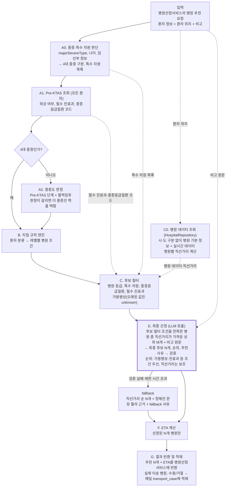

# 응급환자 이송 병원 추천 시스템 설계

2026-10-19 · 초안

## 목차

- [1. 개요](#1-개요)
    - [1.1 핵심 원칙](#11-핵심-원칙)
    - [1.2 범위](#12-범위)
- [2. 입력 필드 사용 방식](#2-입력-필드-사용-방식)
- [3. 전체 처리 플로우](#3-전체-처리-플로우)
    - [3.1 A0. 중증·특수 자원 판단](#31-a0-중증특수-자원-판단)
        - [3.1.1 판정 규칙](#311-판정-규칙)
    - [3.2 A1·A2. 환자 분류](#32-a1a2-환자-분류)
        - [3.2.1 Pre-KTAS 조회 테이블](#321-pre-ktas-조회-테이블)
        - [3.2.2 예시: 65세 남성, 발등 개방성 골절, Pre-KTAS 2단계](#322-예시-65세-남성-발등-개방성-골절-pre-ktas-2단계)
    - [3.3 B. 119 이송지침 규칙 엔진](#33-b-119-이송지침-규칙-엔진)
    - [3.4 C0·C·E. 병원 데이터 조회, 후보 필터, LLM 최종 선정](#34-c0ce-병원-데이터-조회-후보-필터-llm-최종-선정)
        - [3.4.1 C0. 병원 데이터 조회](#341-c0-병원-데이터-조회)
        - [3.4.2 C. 후보 필터](#342-c-후보-필터)
        - [3.4.3 E. 최종 선정 절차](#343-e-최종-선정-절차)
    - [3.5 G. 이송 사례 메모리](#35-g-이송-사례-메모리)
        - [3.5.1 원칙](#351-원칙)
        - [3.5.2 집계 레벨](#352-집계-레벨)
        - [3.5.3 스키마](#353-스키마)
        - [3.5.4 적재](#354-적재)
- [4. 인프라와 평가](#4-인프라와-평가)
    - [4.1 평가](#41-평가)
- [5. 미결 사항과 구현 순서](#5-미결-사항과-구현-순서)
    - [5.1 미결 사항](#51-미결-사항)
    - [5.2 구현 순서](#52-구현-순서)
- [6. 나중에 추가할 항목](#6-나중에-추가할-항목)

## 1. 개요

이 시스템은 병원선정서비스에서 입력한 환자 정보와 현재 위치를 받아, 이송할 병원 후보 N개(기본 3개)를 추천 근거와 함께 반환한다. 시스템은 병원 정보를 Postgres에서 조회한다. 구체적인 조회 방법은 아직 정하지 않았으며, 시스템은 `HospitalRepository` 인터페이스를 통해서만 병원 정보에 접근한다.

### 1.1 핵심 원칙

- **이송병원 선정 기준은 규칙 엔진이 판정하고, LLM은 규칙 엔진을 통과한 병원 중에서만 고른다.** 개발팀은 119구급대 운영지침의 이송병원 선정 기준을 규칙 엔진의 설정 파일로 작성하고 버전을 관리한다. LLM은 규칙 엔진이 남긴 후보 병원 중에서 N개를 고르고 추천 근거를 작성한다.
- **LLM은 거리보다 병원의 진료 여건을 먼저 본다.** LLM은 후보 병원의 순위를 정할 때 가용병상, 진료과 같은 조건을 환자 위치와 병원 사이의 직선거리보다 우선한다. 직선거리는 보조적으로 쓴다. 심폐정지 환자는 예외로, LLM은 직선거리가 가장 짧은 병원을 1순위에 둔다. LLM이 직선거리가 가장 짧은 병원이 아닌 병원을 1순위에 두면, 시스템은 그 추천에 우회 표시를 붙이고 LLM에게 우회 사유를 반드시 작성하게 한다.
- **시스템은 후보가 없을 때 조건을 임의로 낮춰 추천하지 않는다.** 지침이 허용하는 모든 완화 단계를 적용해도 후보가 0곳이면, 시스템은 추천하지 않는다.
- **시스템은 LLM이 실패해도 항상 응답한다.** LLM 출력이 검증을 통과하지 못하거나 LLM 호출이 제한 시간을 넘기면, 시스템은 직선거리가 짧은 순서로 N개를 골라 응답한다(이하 fallback).
- **최종 이송 병원은 사람이 결정한다.** 시스템은 추천만 하고, 구급대원과 지도의사가 최종 이송 병원을 결정한다.

### 1.2 범위

- 병원 후보: 시스템은 환자 위치의 시·도를 판별하지 않고, 시·도 경계와 관계없이 병원을 조회한다. 시스템은 환자 위치와 병원 사이의 직선거리로 가까운 병원을 고른다. 그래서 지침의 "타 시·도 권역외상센터가 더 가까우면 그곳으로 이송할 수 있다"는 조항은 별도 처리 없이 지켜진다.
- 이송 사례 메모리: 시스템은 환자 위치와 같은 시·도에서 발생한 과거 이송 사례만 사용한다.

## 2. 입력 필드 사용 방식

병원선정서비스가 보내는 요청의 형식(필드명, 타입, 필수 여부)은 [interface.md](interface.md)의 '병원 추천 요청' 섹션에 정의되어 있다. 시스템은 각 입력 필드를 다음과 같이 사용한다.

| 입력 필드 | 시스템이 이 필드를 사용하는 목적 | 처리 방식 |
| --- | --- | --- |
| `majorSevereType` (4대중증구분) | 지침의 환자 분류(심정지, 중증외상, 뇌졸중, 심근경색)를 바로 결정 | 규칙, 다른 필드보다 우선 적용 |
| `preKtas.assessmentDetail` (Pre-KTAS 평가내용) | Pre-KTAS(병원 전 단계 중증도 분류)의 평가 항목 문구. 외상 여부, 필수·보조 진료과, 중증응급질환 코드, 사례 집계 키를 찾는 데 사용 | Pre-KTAS 조회 테이블 |
| `preKtas.level` (Pre-KTAS 단계) | 중증도 판정 (1~2단계면 중증 후보) | 규칙 |
| `vitalSigns` (활력징후) | 중증외상의 생리학적 기준 판정, LLM 선정 시 참고 | 규칙 + LLM 입력 |
| `consciousnessLevel` (의식상태) | 중증외상 기준 판정, LLM 선정 시 참고 | 규칙 + LLM 입력 |
| `patientInfo.age` (나이) | 15세 미만이면 소아응급 진료 가능 조건을 후보 필터에 추가 | 규칙 |
| `specialPatientInfo` (특수환자정보) | 임산부면 분만 가능 조건을 후보 필터에 추가. 신생아 정보는 우선 고려하지 않음 | 규칙 (완화 불가 조건) |
| `medicalHistory` (과거력), `medications` (투여약물) | LLM이 선정 근거를 쓸 때 참고 (예: 당뇨 + 혈당 210 → 감염 위험 언급) | LLM 입력만 |
| `patientLocation` (환자위치, WGS84 경도·위도) | 직선거리·ETA 계산, 사례 집계의 지역 키 | 코드 |
| `remark` (비고) | 최종 선정 LLM이 최종 후보, 순위, 추천 사유를 정할 때 참고 (예: 환자가 희망하는 병원). 비고에 적힌 거절 병원은 후보에서 제거하지 않음 | LLM 입력만 |

중증응급질환 코드는 병원이 실시간으로 공개하는 "중증응급질환 수용가능 정보"(질환별로 지금 환자를 받을 수 있는지 여부)의 질환 항목을 가리킨다.

## 3. 전체 처리 플로우



- 굵은 테두리 상자는 LLM을 호출하는 단계다. 시스템은 요청 한 건당 LLM을 최대 1회 호출한다.
- 레벨 범례: L0은 지침의 원칙 조건, L1은 의료지도를 받아야 적용할 수 있는 완화 조건이다. 레벨별 조건은 '119 이송지침 규칙 엔진' 섹션의 분류별 규칙 표에 있다.

최종 선정 LLM이 실패하면 시스템은 fallback으로 응답한다. 시스템은 최종 선정이나 fallback으로 고른 N개 병원에만 ETA를 계산한다. 그 전 단계는 ETA 대신 환자 위치와 병원 사이의 직선거리를 쓴다. 시스템은 결과 반환 및 적재(G단계)에서 추천 결과를 병원선정서비스에 반환하고, 실제 이송 병원과 수용/거절 결과를 매일 `transport_case` 테이블에 적재한다.

### 3.1 A0. 중증·특수 자원 판단

시스템은 요청을 받으면 가장 먼저 환자가 4대 중증에 해당하는지와 특수 자원이 필요한지 판단한다. 이 단계에서 시스템은 LLM이나 조회 테이블을 쓰지 않고 입력 필드 값만 본다.

- 입력 필드: `majorSevereType`, `patientInfo.age`, `specialPatientInfo.pregnancyInfo`
- 출력
    - `severe_type`: 4대 중증 구분 (심정지, 중증외상, 뇌졸중, 심근경색 중 하나, 또는 없음)
    - `required_resources[]`: 환자에게 필요한 특수 자원 목록. 목록이 비어 있으면 특수 자원이 필요 없다.
- 출력을 쓰는 단계
    - `severe_type` 값이 있으면 시스템은 중증도 판정(A2단계)을 건너뛰고, '판정 규칙' 표의 적용 규칙을 지침 규칙 엔진(B단계)에 넘긴다.
    - `severe_type` 값이 없으면 시스템은 중증도 판정(A2단계)에서 Pre-KTAS 단계와 활력징후로 적용 규칙을 정한다.
    - `severe_type` 값과 관계없이 모든 환자는 Pre-KTAS 조회(A1단계)를 거친다.
    - 후보 필터(C단계)는 `required_resources[]`의 자원을 완화할 수 없는 조건으로 적용한다.

소아와 임산부 여부는 처리 흐름을 나누지 않는다. 소아와 임산부는 중증일 수도 있고 경증일 수도 있어서, 시스템은 이 환자들도 Pre-KTAS로 분류해야 한다. 예를 들어 7세 손목 골절 환자에게는 소아 응급 진료 자원이 필요하지만, 시스템은 이 환자에게 경증외상 규칙을 적용한다.

#### 3.1.1 판정 규칙

| 판정 근거 | 적용 규칙 | 특수 자원 | 병원 데이터 (erd_hospital.mmd) |
| --- | --- | --- | --- |
| `majorSevereType` = 심정지 | 심폐정지 | 없음 (잠정) | - |
| `majorSevereType` = 중증외상 | 중증외상 | 없음 | - |
| `majorSevereType` = 뇌졸중 | 뇌졸중 | 뇌경색 재관류중재술 또는 뇌출혈수술 (둘 중 하나라도 가능하면 충족) | 중증질환환자수용가능정보 `mkioskty2`([재관류중재술] 뇌경색), `mkioskty3`·`mkioskty4`([뇌출혈수술]) |
| `majorSevereType` = 심근경색 | 비외상 중증 | 심근경색 재관류중재술 | 중증질환환자수용가능정보 `mkioskty1`([재관류중재술] 심근경색) |
| `patientInfo.age` < 15 | - | 소아 응급 진료 | 응급실시간가용병상정보 `hv28`(소아) |
| `specialPatientInfo.pregnancyInfo` 값 있음 | - | 분만 | 중증질환환자수용가능정보 `mkioskty16`([산부인과응급] 분만) |

- 적용 규칙 열이 '-'인 행은 적용 규칙을 바꾸지 않는다. 이 환자의 적용 규칙은 4대 중증 구분이나 중증도 판정(A2단계)이 정한다.
- 중증외상 환자의 권역외상센터 조건은 특수 자원으로 두지 않는다. 지침은 의료지도를 받으면 지역응급의료센터로 이송하는 것을 허용하므로, 시스템은 이 조건을 지침 규칙 엔진의 병원 등급 조건(L0 권역외상센터, L1 지역응급의료센터)으로 처리한다.
- 신생아는 우선 고려하지 않는다. 시스템은 `specialPatientInfo.newbornInfo` 값을 특수 자원 판단에 사용하지 않는다.

### 3.2 A1·A2. 환자 분류

시스템은 환자 분류 대부분을 LLM 호출 없이 규칙과 Pre-KTAS 조회 테이블로 결정한다. 환자 분류는 두 단계로 나뉜다.

- **Pre-KTAS 조회(A1단계):** 모든 환자가 이 단계를 거친다.
    - 시스템은 `preKtas.assessmentDetail` 문구로 Pre-KTAS 조회 테이블에서 외상 여부, 필수·보조 진료과, 중증응급질환 코드를 찾는다.
    - 시스템은 필수 진료과와 중증응급질환 코드를 후보 필터(C단계)의 조건으로 넘긴다.
    - 4대 중증 환자도 이 단계를 거치므로, 예를 들어 Pre-KTAS 평가내용이 "개방성 골절"인 중증외상 환자에게는 '정형외과 필수' 조건이 붙는다.
- **중증도 판정(A2단계):** 4대 중증이 아닌 환자(중증·특수 자원 판단 단계에서 `severe_type` 값이 없는 환자)만 이 단계를 거친다.
    - 시스템은 Pre-KTAS 단계와 활력징후로 중증도를 판정한다. 중증외상 여부는 "다발성/중증손상" 지침의 기준으로 판정한다.
    - 시스템은 외상 여부와 중증도로 적용 규칙(중증외상, 경증외상, 비외상 중증, 비외상 경증)을 정해 지침 규칙 엔진(B단계)에 넘긴다.

**판정이 갈리면 더 중증인 쪽을 택한다.** Pre-KTAS 단계와 활력징후가 서로 다른 중증도를 가리키면, 시스템은 가장 중증인 판정을 따른다. 개발팀은 활력징후 임계치(수축기혈압, 산소포화도, 의식 수준)를 "이 값을 넘으면 중증으로 올린다"는 조건으로 규칙 설정 파일에 작성한다.

- 활력징후 기록이 여러 건이면, 시스템은 중증도를 판정할 때 가장 나쁜 값을 쓰고 화면에 표시할 때 가장 최근 값을 쓴다.
- 요청의 `preKtas`에는 Pre-KTAS 평가 결과가 한 건만 들어간다. `preKtas.assessmentRound`는 그 평가의 차수다. 평가를 여러 차례 했을 때 병원선정서비스가 어느 차수의 결과를 보내는지는 미결 사항이다.
- `preKtas.assessmentDetail` 문구가 조회 테이블에 없으면, 시스템은 Pre-KTAS 단계만으로 분류하되 판단이 갈리면 중증 쪽을 택한다. 시스템은 응답에 "평가내용 미등록" 경고를 포함한다.

#### 3.2.1 Pre-KTAS 조회 테이블

개발팀은 과거 이송 데이터에서 `preKtas.assessmentDetail`에 해당하는 평가내용의 고유값을 추출하고, 배포 전에 LLM으로 조회 테이블 초안을 만든다. 의료진이 초안을 검토해 확정한다. 시스템은 실행 중에 이 테이블을 조회만 하고, 테이블을 만들기 위해 LLM을 호출하지 않는다.

| 컬럼 | 예시 |
| --- | --- |
| 평가내용 (키) | 15세 이상 - 근골격계 - 하지 손상 - 개방성 골절 또는 신경혈관 장애 |
| is_trauma | true |
| required_depts | 정형외과 |
| supportive_depts | 성형외과, 혈관외과 |
| severe_disease_code | null |

#### 3.2.2 예시: 65세 남성, 발등 개방성 골절, Pre-KTAS 2단계

이 환자는 `majorSevereType` 값이 없으므로, 시스템은 Pre-KTAS 조회 테이블에서 "외상, 정형외과 필수"를 찾는다. 활력징후가 안정적이고 손상 부위가 발등 한 곳이므로, 이 환자는 중증외상 기준에 해당하지 않을 가능성이 높다. 다만 이 판단은 "다발성/중증손상" 지침으로 확인해야 한다. 중증외상이 아니면 시스템은 경증외상 규칙을 적용한다. 후보 필터는 정형외과 진료가 불가능한 병원을 후보에서 제거한다. LLM은 남은 후보 중 가용병상과 정형외과 여건이 더 나은 병원을 직선거리가 가장 짧은 병원보다 앞 순위에 둘 수 있고, 이때 시스템은 그 추천에 우회 표시를 붙인다.

### 3.3 B. 119 이송지침 규칙 엔진

지침은 환자 분류에 따라 병원의 최소 등급을 정하고, 그 등급 이상인 병원 중 가장 가까운 병원으로 이송하라고 규정한다. 규칙 엔진은 이 기준을 설정 파일로 표현하므로, 지침이 개정되면 개발팀은 코드 대신 설정 파일만 수정한다. 규칙 엔진은 환자 분류만 입력으로 받는다. 시스템은 환자 위치의 지역을 판별하지 않으므로, 지역에 따라 달라지는 지침(응급의료 취약지역, 지역이송지침)은 '나중에 추가할 항목' 섹션으로 옮겼다.

| 환자 분류 | L0 원칙 조건 | L1 완화 조건 (의료지도 필요) |
| --- | --- | --- |
| 중증외상 | 가장 가까운 권역외상센터 (시·도와 관계없음) | 지역응급의료센터 |
| 경증외상 | 가장 가까운 지역응급의료기관 | 없음 |
| 비외상 중증 | 지역응급의료센터 이상 | 지역응급의료기관 |
| 비외상 경증 | 가장 가까운 지역응급의료기관 | 없음 |
| 심폐정지 | 가장 가까운 지역응급의료기관 이상 | 없음 |
| 뇌졸중 의증 | 지역응급의료센터 이상 | 지역응급의료기관 |
| 뇌졸중 선별검사 양성 | 즉시 혈전용해 치료가 가능한 지역응급의료기관 이상 | 지역응급의료기관 |

- 분류별 규칙 표의 병원 등급 조건은 후보 필터가 적용한다. 표의 "가장 가까운"은 후보 필터의 조건이 아니다. 등급 조건을 만족한 병원 사이의 순위는 최종 선정 LLM이 정하고, 직선거리는 보조 기준으로 쓴다('핵심 원칙' 참고).
- 지침의 "권역외상센터가 지정되지 않은 지역은 지역응급의료센터 이상" 조항은 적용하지 않는다. 시스템은 시·도와 관계없이 가장 가까운 권역외상센터를 찾는다. 거리 상한이 없으므로, 권역외상센터가 먼 지역에서도 중증외상 환자의 L0 후보는 권역외상센터뿐이다.
- L0 조건으로 후보가 0곳이면, 규칙 엔진은 L1 조건으로 후보 필터를 다시 실행한다. L1 조건으로도 후보가 0곳일 때의 처리는 '나중에 추가할 항목' 섹션의 '직접의료지도 요청' 항목에서 정한다.
- 시스템은 비고에서 뇌졸중 선별검사 결과를 추출하지 않는다. 선별검사 결과를 받을 경로가 정해지기 전까지('미결 사항' 참고), 규칙 엔진은 뇌졸중 환자에게 '뇌졸중 의증' 규칙을 적용한다.
- **헬기 이송은 우선 고려하지 않는다.** 시스템은 헬기 이송이 필요한지 판단하지 않고, 응답에 헬기 검토 권고를 포함하지 않는다.

```text
레벨 진행 (후보 필터 결과가 0곳이면 다음 레벨 조건으로 후보 필터를 다시 실행)

  L0 원칙 조건 ──후보 0곳──▶ L1 완화 조건
       │                         │
       ▼                         ▼
  추천 반환              추천 반환 +
                         "의료지도 필요" 표시
```

### 3.4 C0·C·E. 병원 데이터 조회, 후보 필터, LLM 최종 선정

#### 3.4.1 C0. 병원 데이터 조회

시스템은 `HospitalRepository`로 병원 데이터를 조회한다. 시스템은 시·도 구분 없이 병원을 조회하고, 환자 위치와 각 병원 사이의 직선거리를 계산한다. 후보 필터(C단계)와 최종 선정(E단계)이 조회한 데이터를 쓴다.

| 데이터 | 쓰는 곳 | 병원 데이터 (erd_hospital.mmd) |
| --- | --- | --- |
| 응급의료기관 등급, 진료과목, 병원 좌표 | 후보 필터의 병원 등급·필수 진료과 조건, 직선거리 계산 | 응급의료기관목록정보조회 `dutyemcls`, `qd`, `wgs84lon`·`wgs84lat` |
| 외상센터 등급 | 후보 필터의 병원 등급 조건 (권역외상센터) | 외상센터위치정보조회 `dutylvkl` |
| 응급실·중환자실·소아 가용병상, 입력일시 | 후보 필터의 가용병상·특수 자원 조건, 실시간 데이터 신선도 판정, 최종 선정 | 응급실시간가용병상정보조회 `hvec`, `hvicc` 등, `hv28`, `hvidate` |
| 중증질환 수용가능 여부 | 후보 필터의 중증응급질환·특수 자원 조건, 최종 선정 | 중증질환환자수용가능정보조회 `mkioskty1` 등 |
| 응급실·중증질환 진료불가 메시지 | 후보 필터의 필수 진료과 조건, 최종 선정 | 응급실및중증질환메시지조회 `symblkmsg` |

#### 3.4.2 C. 후보 필터

후보 필터는 코드로 조건에 맞지 않는 병원을 제거한다. LLM은 남은 후보 병원과 비고 원문을 보고 최종 후보 N개와 순위를 정하고, 병원마다 추천 사유를 작성한다. 시스템은 LLM 출력이 검증을 통과한 경우에만 그 출력을 응답에 사용한다.

**후보 필터의 조건**

| 조건 | 적용 대상 환자 | 레벨이 내려갈 때 조건을 낮출 수 있는지 |
| --- | --- | --- |
| 병원 등급 (규칙 엔진이 정한 레벨별 조건) | 모든 환자 | 레벨에 따라 낮춤 |
| 해당 질환의 중증응급질환 수용가능 = Y | 중증응급질환 코드가 있는 환자 | 낮추지 않음 |
| 필수 진료과 보유 + 해당 진료과의 실시간 진료불가 메시지 없음 | 필수 진료과가 있는 환자 | 낮추지 않음 |
| 특수 자원 보유 (중증·특수 자원 판단 단계의 `required_resources[]`) | 뇌졸중, 심근경색, 소아, 임산부 환자 | 낮추지 않음 |
| 응급실 가용병상 > 0 | 심폐정지를 제외한 모든 환자 | 낮추지 않음 |
| 중환자실 가용병상 > 0 | 중증 환자 (적용 여부는 규칙 설정 항목, 의료진 확인 필요) | 설정에 따름 |

- **실시간 데이터가 오래된 경우:** 시스템은 병원별 `data_as_of`를 기록한다. 갱신 후 임계치(예: 10~15분)가 지난 병상 값을 시스템은 `unknown`으로 처리한다. 시스템은 값이 `unknown`인 병원을 후보에서 제거하지 않는다. 시스템은 LLM 프롬프트에 그 병원의 병상 값을 `unknown`으로 넣고, LLM은 가용병상이 확인된 병원보다 그 병원의 순위를 낮춘다. 시스템은 응답에 "병상 정보 오래됨" 경고를 포함한다.

#### 3.4.3 E. 최종 선정 절차

1. 시스템은 후보 필터 조건을 만족한 병원 중 직선거리가 가까운 상위 M개(10~15개) 병원의 데이터를 LLM 프롬프트에 넣는다. 프롬프트에는 환자 상태, 각 후보 병원의 직선거리와 실시간 데이터, 적용한 규칙, 비고 원문이 들어간다.
2. LLM은 N개 병원을 고르고 순위를 정한 뒤, 병원마다 구조화된 추천 사유를 출력한다: `reasons: [{type: rule|realtime|remark, ref, text}]`.
    - LLM은 순위를 정할 때 가용병상, 진료과 같은 조건을 직선거리보다 우선하고, 직선거리는 보조적으로 쓴다. 심폐정지 환자는 예외다('우회 판정 기준' 항목 참고).
    - `type`은 추천 사유의 출처(규칙, 실시간 데이터, 비고)다.
    - `ref`는 그 추천 사유가 가리키는 입력 데이터의 항목이다. `type`이 `remark`이면 `ref`는 비고 원문에서 인용한 문구다.
3. 시스템은 LLM 출력을 검증한다. 시스템은 병원 ID가 후보 목록에 있는지, 출력이 스키마에 맞는지, 우회 규칙을 지켰는지, 각 추천 사유의 `ref`가 입력 데이터에 실제로 있는지(비고 인용 문구는 비고 원문에 있는지) 확인한다.
4. 검증에 실패하거나 LLM 호출이 제한 시간을 넘기면, 시스템은 직선거리 순으로 N개를 고르고 정해진 문장 틀로 근거를 만들어 fallback 사유와 함께 반환한다. 정해진 문장 틀의 근거는 규칙 ID, 직선거리, 가용병상 수를 채운 문장이다(예: "지역응급의료센터 이상 조건 충족, 직선거리 4.2km, 응급실 가용병상 4").
5. 시스템은 최종 선정이나 fallback으로 고른 N개 병원에만 ETA를 계산한다.

- **우회 판정 기준:** 시스템은 1순위 병원의 직선거리가 직선거리 최단 병원보다 X km 넘게 멀 때만 우회로 판정한다. 직선거리 차이가 X km 이하면 시스템은 우회로 판정하지 않는다. 직선거리는 실제 이동 거리와 차이가 크기 때문에 이 기준을 둔다. X 값은 '미결 사항과 구현 순서' 섹션의 설정값 목록에서 정한다.
    - 시스템은 심폐정지 환자를 제외한 모든 환자(중증 환자 포함)에게 우회를 허용한다. 지침이 심폐정지 환자에게 "가장 가까운" 병원을 요구하므로, 시스템은 심폐정지 환자의 우회를 금지한다.
    - LLM은 우회 사유를 가용병상 여건, 진료과 적합성, 환자 희망, 거절 이력 중에서만 고를 수 있다.
- **심폐정지 환자 처리:** 시스템은 심폐정지 환자에게 병원 등급 조건만 적용한다.
- **비고 처리**
    - `remark`가 비어 있거나 생략되면 시스템은 프롬프트에 비고를 넣지 않는다.
    - 시스템은 비고에 적힌 거절 병원을 후보에서 제거하지 않는다.
    - fallback은 LLM을 거치지 않으므로 비고를 반영하지 않는다. 이때 `remark` 값이 있으면 시스템은 응답에 "비고 미반영" 경고를 포함한다.
- **제한 시간:** 시스템은 최종 선정 LLM 호출에 5초(예시값)의 제한 시간을 둔다. vLLM의 대기 요청 수가 정해진 값을 넘으면, 시스템은 LLM을 호출하지 않고 fallback으로 응답한다. 이 규칙은 다수사상자 사고처럼 요청이 몰리는 상황에 대비한다.

### 3.5 G. 이송 사례 메모리

**사례 집계는 추후 고려한다.** 사례 집계는 현재 처리 흐름에 포함하지 않는다. 이 섹션의 '원칙'과 '집계 레벨' 항목은 추후 검토할 사례 집계 초안이다. 결과 반환 및 적재(G단계)와 `transport_case` 스키마는 현재 처리 흐름에 포함된다.

사례 집계는 "이 유형의 환자를 각 후보 병원이 과거에 얼마나 수용했는가"를 Postgres의 `GROUP BY` 집계로 계산한다. 시스템은 임베딩과 코사인 유사도를 사용하지 않는다. `GROUP BY` 집계는 결과를 설명하기 쉽고, pgvector 확장이 필요 없으며, 임베딩 모델을 따로 운영하지 않아도 된다.

#### 3.5.1 원칙

- 사례 집계 결과는 후보 필터 조건에 쓰이지 않고, 최종 선정(E단계) LLM 입력에만 포함된다. LLM은 실시간 데이터와 사례 집계 결과가 다르면 실시간 데이터를 우선한다.
- 결과 데이터에는 수용/거절 여부만 있으므로, 시스템과 LLM은 사례 집계 결과를 "적합하다"가 아니라 "과거 수용률이 높다"로만 표현한다.
- 어떤 병원의 사례 수가 최소 건수에 못 미치면, 시스템은 그 병원을 "데이터 부족"으로 표시하고 순위를 낮추지 않는다. 인접 시·도 권역외상센터는 사례가 없으므로 항상 "데이터 부족"으로 표시된다. 이 경우 LLM은 근거에 "타 시·도 권역외상센터 이송 가능" 지침 조항을 명시한다.
- 사례 집계 쿼리는 환자 위치와 같은 시·도에서 최근 6~12개월 동안 발생한 사례만 조회한다.

#### 3.5.2 집계 레벨

| 집계 레벨 | 같은 값으로 묶는 기준 |
| --- | --- |
| Level 1 | Pre-KTAS 평가내용 + Pre-KTAS 단계 (+ 주간/야간) |
| Level 2 | Pre-KTAS 대분류(예: 근골격계) + Pre-KTAS 단계 |
| Level 3 | 외상/비외상 + 중증도 |

시스템은 후보 병원마다 사례가 5건 이상 나오는 가장 좁은 집계 레벨(Level 1이 가장 좁음)을 선택한다. 사례 집계의 출력은 병원별 `{hospital_id, match_level, cases, accepted_rate, rejected_count}`와 대표 사례 2~3건이다. 대표 사례에 자유 텍스트가 들어가면 환자를 특정할 위험이 있으므로, 시스템은 대표 사례를 정형 필드로만 구성한다.

#### 3.5.3 스키마

```text
transport_case
  case_id, sido, created_at, time_bucket, region_cell
  pre_ktas_text, pre_ktas_stage, pre_ktas_table_version
  classification_type, severity, severe_disease_code
  recommended_hospitals[], recommended_by_system (bool)
  chosen_hospital_id, accepted (bool), rejected_hospitals[], rejected_at
  source ('backfill' | 'live')
```

- `time_bucket`: 이송 시각의 주간/야간 구분
- `region_cell`: 환자 위치를 격자 단위로 낮춘 지역 코드 (환자 비식별 목적)
- `recommended_by_system`: 실제 이송 병원이 시스템의 추천 목록에 있었는지 여부. 시스템이 추천한 병원이 환자를 더 많이 받게 되어 그 병원의 수용률이 계속 오르는 자기강화 효과를 개발팀이 측정할 때 쓴다. 과거 데이터에는 추천 목록이 없다.

#### 3.5.4 적재

- 과거 데이터 적재: 개발팀은 과거 구급 기록(정형 데이터)에서 환자 식별 정보를 제거한 뒤 `transport_case`에 적재한다. 과거 기록에도 같은 Pre-KTAS 필드가 있으므로 별도 분류 변환이 필요 없다.
- 결과 반환 및 적재(G단계): 시스템은 운영 중에 실제 이송 병원과 수용/거절 결과를 해당 요청의 감사 로그와 연결하고, 매일 `transport_case`에 새 사례를 추가한다.
- 현재 데이터에는 거절 사유가 없으므로, 시스템은 거절이 병상 부족 때문인지 진료 역량 부족 때문인지 구분할 수 없다.

## 4. 인프라와 평가

개발팀이 새로 추가하는 인프라는 vLLM 하나다. 시스템은 나머지 기능을 기존 Postgres와 애플리케이션 코드로 처리한다.

| 구성 요소 | 선택 | 비고 |
| --- | --- | --- |
| DB | Postgres (pgvector 사용 불가) | 병원 데이터, `transport_case` 저장 |
| LLM 서빙 | vLLM (로컬 서버) | 후보 모델: qwen 3.8 flash next, solar2 int4 GlobalPruned (세부 사양 미확인) |
| LLM 출력 형식 제한 | vLLM structured outputs (JSON 스키마) | temperature 0 |
| LLM 호출 | 요청당 최대 1회 | 최종 선정. 임베딩 모델은 사용하지 않음 |
| 거리 비교 (최종 선정 전) | 환자 위치와 병원 사이의 직선거리 | 후보 정렬, 상위 M개 선택, 우회 판정, fallback 순서에 사용 |
| ETA 계산 | 최종 선정된 N개 병원에만 계산. 직선거리로 추정해서 시작 | `EtaProvider` 인터페이스로 분리해 나중에 도로 기반 계산으로 교체. 응답에 ETA 계산 방식 표시 |
| 병원 조회 | `HospitalRepository` 인터페이스 | 시·도 구분 없이 조회. 조회 방법은 추후 구현 |

### 4.1 평가

개발팀은 과거 이송 데이터로 평가셋을 만들고, 두 후보 모델을 같은 평가셋으로 비교한다. 비교 지표는 다음과 같다.

- 실제로 환자를 수용한 병원이 시스템의 추천 N개 안에 들어간 비율
- 지침을 위반한 추천 건수 (목표 0건)
- LLM 출력이 스키마 검증에 실패한 비율
- 비고 반영 정확도 (비고 내용을 순위와 추천 사유에 맞게 반영했는지, 특히 "FAST 음성" 같은 부정 표현을 반대로 읽지 않는지)
- 응답 지연 시간의 95번째 백분위 값

## 5. 미결 사항과 구현 순서

개발팀이 구현을 시작하려면 입력 필드의 값 목록과 중증외상 판정 기준이 먼저 정해져야 한다. 나머지 항목은 설정값이므로 구현하면서 정할 수 있다.

### 5.1 미결 사항

- [ ] "다발성/중증손상" 지침의 중증외상 판정 기준. 기준 문서를 받기 전까지 시스템은 "Pre-KTAS 1~2단계 + 외상이면 중증외상"이라는 잠정 규칙을 적용하고, 응답의 적용 규칙 정보에 잠정 규칙임을 표시한다.
- [ ] `majorSevereType`, `patientInfo.sex`, `patientInfo.patientType`, `consciousnessLevel` 필드에 들어갈 수 있는 값 전체 목록 (interface.md의 '미정 항목'과 같은 내용)
- [ ] Pre-KTAS 평가를 여러 차례 했을 때 병원선정서비스가 `preKtas`에 어느 차수의 결과를 보내는지
- [ ] `preKtas.assessmentDetail`의 전체 값 목록 (과거 데이터의 고유값). 이 목록이 있어야 개발팀이 조회 테이블 초안을 만들고 의료진이 검토할 수 있다.
- [ ] 병원선정서비스가 뇌졸중 선별검사 결과를 정형 필드로 보낼 수 있는지
- [ ] DB의 병원 데이터에 응급의료기관 등급, 권역외상센터 지정 여부, 혈전용해 치료 가능 여부, 실시간 진료불가 메시지 필드가 있는지
- [ ] 설정값: 추천 개수 N, LLM에 넣는 후보 수 M, 우회 판정 기준 X km, 실시간 데이터 신선도 임계치, 중환자실 가용병상 조건 적용 여부, LLM 호출 제한 시간
- [ ] 2단계 응답 여부. 시스템이 직선거리 순 추천을 먼저 반환하고, LLM이 정한 순위와 추천 사유를 준비되는 대로 추가로 보내는 방식이다. 이 방식을 쓰면 LLM 응답을 기다리는 지연이 사라진다. 병원선정서비스가 응답을 두 번 받아 화면을 갱신할 수 있는지에 따라 정한다.
- [ ] 거절 병원 정보를 받을 경로. 지금은 비고에 적힌 거절 병원을 후보에서 제거하지 않는다. 병원선정서비스가 거절 병원 ID를 정형 필드로 보낼지, 시스템이 거절 병원을 처리하지 않을지 정해야 한다. 이 결정에 따라 우회 사유 "거절 이력"의 출처도 정해진다.
- [ ] 사례 집계를 추가할 때의 집계 기준. 집계 레벨에서 주간/야간 구분을 뺄지 정한다. 사례 집계는 '나중에 추가할 항목' 섹션의 추후 고려 항목이다.

### 5.2 구현 순서

1. 개발팀은 요청 검증(interface.md의 '필수 여부 규칙'), 규칙 엔진(환자 분류 → 레벨별 병원 조건 표)을 구현한다. 검증: 분류별 규칙 표의 각 행에 대한 단위 테스트, 판정이 갈릴 때 가장 중증인 판정을 택하는지 확인하는 테스트.
2. 개발팀은 mock 병원 DB, 후보 필터, 직선거리 계산, ETA 계산을 구현한다. 검증: 발등 개방성 골절 예시 환자로 입력부터 응답까지 전체 흐름이 동작하는지 확인.
3. 개발팀은 vLLM 연동(최종 선정), LLM 출력 검증, fallback을 구현한다. 검증: LLM 호출 실패와 제한 시간 초과를 일부러 발생시켰을 때 시스템이 fallback으로 응답하는지 확인.
4. 개발팀은 평가셋으로 두 후보 모델을 비교한다. 검증: '인프라와 평가' 섹션의 평가 지표 리포트.

## 6. 나중에 추가할 항목

다음 항목은 중요하지만, 나머지 처리 흐름을 모두 정리한 뒤 추가한다.

- **직접의료지도 요청(L2)**
    - L0 조건과 L1 조건 모두에서 후보가 0곳일 때 시스템이 반환하는 응답이다.
    - 특수 자원 조건 때문에 후보가 0곳이면 L1 조건을 건너뛰고 바로 직접의료지도 요청으로 가는 경로를 포함한다.
    - 후보 필터를 적용하기 전의 직선거리 순 근접 병원과 각 병원의 탈락 사유(예: 응급실 가용병상 0, 정형외과 진료불가)를 참고 목록으로 함께 반환하는 방식을 다시 검토한다.
- **응답 스키마**
    - interface.md의 Response Body가 비어 있다.
    - 이 문서에서 시스템이 응답에 포함한다고 적은 내용(추천 병원 목록과 추천 사유, 우회 표시, "의료지도 필요" 표시, 경고 목록, fallback 사유, ETA 계산 방식, 적용 규칙 정보)을 담을 필드를 정한다.
- **감사 로그**
    - vLLM은 여러 요청을 묶어 처리하므로, temperature를 0으로 설정해도 같은 입력에 같은 출력이 나온다는 보장이 없다. 그래서 시스템은 판단에 사용한 데이터를 요청마다 저장해야 한다.
    - 결과 반환 및 적재(G단계)는 감사 로그를 이용해 실제 이송 결과를 해당 요청과 연결한다.
- **사례 집계 (추후 고려)**
    - 후보 병원별 과거 수용률을 계산해 최종 선정 LLM에 참고 정보로 넣는 기능이다.
    - 초안은 '이송 사례 메모리' 섹션에 있다. 사례 집계는 결과 반환 및 적재(G단계)가 쌓는 `transport_case` 테이블을 조회한다.
    - 추가하면 최종 선정 LLM의 프롬프트에 사례 집계 결과를 넣고, 추천 사유의 `type`에 과거 사례(`case`)를 다시 추가한다.
- **지역에 따라 달라지는 지침 (응급의료 취약지역, 지역이송지침)**
    - 이 지침을 적용하려면 시스템이 환자 위치의 지역(시·군·구)을 판별해야 한다. 지금은 지역을 판별하지 않는다.
    - 응급의료 취약지역의 병원 조건 (지침 원문 기준)
        - 중증외상: 가장 가까운 지역응급의료기관 이상 (지침의 헬기 이송 선택지는 제외)
        - 비외상 중증: 가장 가까운 응급의료기관 이상
        - 뇌졸중 의증, 뇌졸중 선별검사 양성: 가장 가까운 지역응급의료기관
        - 경증외상, 비외상 경증, 심폐정지: 취약지역이 아닌 지역과 같음
    - 지역이송지침: 지역이송지침을 운영하는 지역에서 환자가 적용 대상이면, 규칙 엔진은 분류별 규칙 표 대신 지역이송지침의 규칙을 적용한다.
